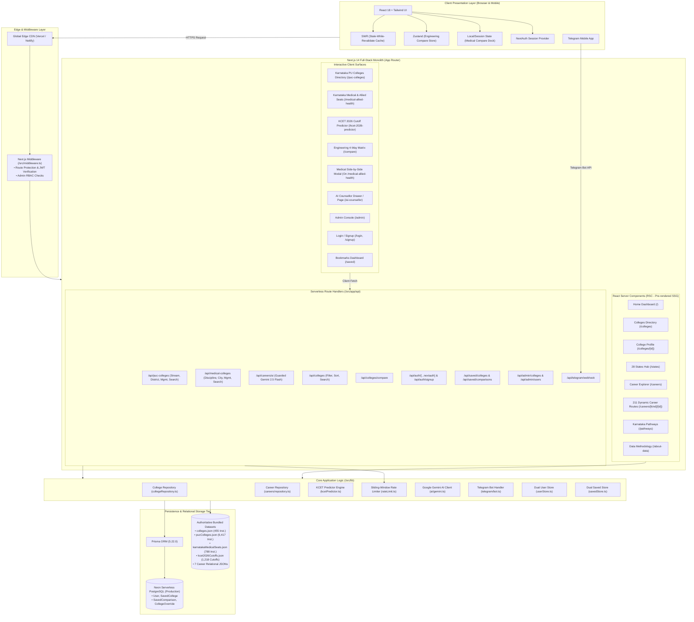

# 🎓 EduSelect — Comprehensive Project Overview, Architecture & Viva Defence Guide

> **Official Project Title:** EduSelect — Pan-India Higher Education Discovery & Algorithmic Career Guidance Ecosystem  
> **Platform Version:** `1.2.0` (Production-Ready • Complete Karnataka Expansion & Neon DB Integrated)  
> **Live Production Repository:** [github.com/mouneshbelavadi/edu-select](https://github.com/mouneshbelavadi/edu-select)  
> **Target Audience:** Indian Secondary & Senior Secondary Students (Class 10, Class 12 PCM/PCB/PCMC/PCMB/Commerce/Arts), Polytechnic Diploma & ITI Holders, Engineering Aspirants, Medical & Allied Health Aspirants, Undergraduates, and Parents  
> **Evaluation Focus:** Full-Stack Web Architecture, Information Retrieval, Rule-Calibrated LLM Orchestration, Dual-Subsystem Comparative Analytics, and Admissions Cutoff Normalization  

---

## Document Purpose & Navigation

This guide serves as the definitive **single source of truth** for the **EduSelect** platform. It provides an exhaustive, end-to-end explanation of the project—from its socio-economic problem statement and academic literature grounding to its system architecture, algorithmic pipelines, complete page-by-page and button-by-button UI interaction specifications, codebase implementation, and faculty viva defense answers.

Someone with no prior knowledge of this repository can read this document to understand:
1. **What** the platform does and the exact capabilities it offers across pan-India and state-level Karnataka modules.
2. **Why** it is needed in India's higher education landscape to eliminate predatory counseling and commercial lead-generation bias.
3. **How** it was designed, architected, and built using Next.js 14 App Router, TypeScript, Neon Serverless PostgreSQL, Prisma ORM, and Google Gemini AI.
4. **Every single page, button, dropdown, modal, and drawer** implemented in the application down to the granular interaction level.
5. **How** to run, test, demonstrate, and defend the project before an academic evaluation panel.

---

## Table of Contents

1. [Project Definition & Core Concept](#1-project-definition--core-concept)
2. [Source of the Problem](#2-source-of-the-problem)
3. [Keywords and Terminology](#3-keywords-and-terminology)
4. [Abstract](#4-abstract)
5. [Introduction](#5-introduction)
6. [Literature Survey](#6-literature-survey)
7. [Research Gap and Objectives](#7-research-gap-and-objectives)
8. [Methodology and System Architecture](#8-methodology-and-system-architecture)
9. [Technology Stack](#9-technology-stack)
10. [Detailed Implementation & Subsystem Deep Dives](#10-detailed-implementation--subsystem-deep-dives)
11. [Complete Page-by-Page & Button-by-Button Specification Matrix](#11-complete-page-by-page--button-by-button-specification-matrix)
12. [Working Demonstration & Step-by-Step Walkthrough](#12-working-demonstration--step-by-step-walkthrough)
13. [Implementation Status Matrix & 10 Automated Verification Suites](#13-implementation-status-matrix--10-automated-verification-suites)
14. [Presentation Preparation (Exact 6-Slide Structure)](#14-presentation-preparation-exact-6-slide-structure)
15. [Technical Questions and Answers (Faculty Viva Defense)](#15-technical-questions-and-answers-faculty-viva-defense)

---

## 1. Project Definition & Core Concept

### 1.1 Project Title & Core Concept
**EduSelect** is an open-access, full-stack higher education discovery and career navigation platform engineered specifically for the Indian educational ecosystem. At its core, the platform bridges the systemic disconnect between **institutional selection** (where students choose a college) and **career trajectory planning** (where that degree leads in industry, higher academia, or public service).

Unlike generic search aggregators that treat college admissions as lead-generation classifieds, EduSelect operates as an **objective, relational decision engine**. It connects:
1. **455 Verified Engineering Colleges** across all 28 Indian States with official NIRF 2025 rankings, verified tuition ranges, and branch offerings.
2. **6,417 Karnataka DPUE Pre-University Colleges** across 32 educational districts with verified Science (PCMB/PCMC), Commerce (EBAC/HEBA), and Arts (HEPS) streams.
3. **788 Karnataka Medical & Allied Health Colleges** covering 67 MBBS, 28 BDS, 43 Pharmacy, and 650 B.Sc Nursing colleges with official KEA approved intake and government vs. private seat quotas.
4. **1,218 KEA UGCET 2026 Cutoff Matrix Entries** covering 250 Karnataka engineering colleges across all reservation categories (GM, 2A, 2B, 3A, 3B, SC, ST) with deterministic 50:50 composite normalization.
5. **14 Karnataka State Vocational & Degree Pathways** mapping DTE Polytechnic Diplomas, PMB Paramedical Diplomas, and Post-PUC degrees to 3-tier salary bands (Fresher, Mid-Career, Senior).
6. **Exhaustive Career Taxonomy** comprising 108 educational pathways, 98 entrance examinations, 31 engineering disciplines, 28 graduate degree trajectories, and 44 central/state government cadres.

```
[Student Profile & Marks]
          │
          ▼
┌────────────────────────────────────────────────────────────────────────┐
│                              EduSelect                                 │
│                                                                        │
│  ┌──────────────────────┐    ┌──────────────────────────────────────┐  │
│  │ College Directories  │    │ Career Explorer (108 Pathways)       │  │
│  │ • 455 Engg (28 St.)  │◄──►│ • Science PCMC, PCB, PCM, PCMB       │  │
│  │ • 6,417 PU Colleges  │    │ • Commerce (EBAC), Arts, Diplomas    │  │
│  │ • 788 Medical Seats  │    │ • 31 Engg Branches & 44 Govt Cadres  │  │
│  └──────────────────────┘    └──────────────────────────────────────┘  │
│              ▲                                  ▲                      │
│              │                                  │                      │
│  ┌───────────┴──────────┐            ┌──────────┴───────────┐          │
│  │ KEA Cutoff Engine    │            │ Hallucination-Safe   │          │
│  │ • 50:50 Composite    │            │ AI Counsellor        │          │
│  │ • 1,218 Cutoffs      │            │ • Candidate Whitelist│          │
│  │ • 7 Quota Categories │            │ • Statutory Guardrail│          │
│  └──────────────────────┘            └──────────────────────┘          │
│              ▲                                  ▲                      │
│              │                                  │                      │
│  ┌───────────┴──────────┐            ┌──────────┴───────────┐          │
│  │ Medical Compare Dock │            │ Neon PostgreSQL DB   │          │
│  │ • Isolated Selection │            │ • Serverless Pooling │          │
│  │ • Seat Ratio & Quotas│            │ • Prisma ORM & Auth  │          │
│  └──────────────────────┘            └──────────────────────┘          │
└────────────────────────────────────────────────────────────────────────┘
          │
          ▼
[Informed, Statutorily Compliant Career Decisions at Zero Cost]
```

### 1.2 Purpose
The purpose of EduSelect is to eliminate information asymmetry, abolish predatory coaching/college advertising bias, and provide equal access to verified career counseling for every student in India—regardless of urban, rural, or socio-economic background—at zero financial cost.

### 1.3 Scope
The platform addresses all critical transition junctures of Indian education:
- **Class 10 (Secondary / SSLC):** Transition into Science (PCMC, PCB, PCM, PCMB), Commerce, Arts/Humanities, Polytechnic Diplomas (DTE Karnataka), or ITI craftsman trades.
- **Class 12 (Higher Secondary / PUC / +2):** Admission into undergraduate engineering (B.Tech / B.E. via KCET, COMEDK, JEE), medicine (MBBS / BDS via NEET-UG), pharmacy (B.Pharm/Pharm.D), nursing (B.Sc Nursing), commerce professional certifications (CA / CS / CMA), design, law, and defense (NDA).
- **Polytechnic & ITI Graduates:** Lateral entry into 2nd-year B.Tech via DCET, public sector apprentice schemes, and defense technical cadres.
- **Undergraduates & Engineering Graduates:** Branch-specific corporate hierarchies, GATE examination trajectories for PSUs, Indian Engineering Services (ESE), state PSC recruitments, and postgraduate research.

### 1.4 Intended Users
| User Group | Primary Needs on EduSelect | Key Platform Features Utilized |
| :--- | :--- | :--- |
| **High School Students (Class 10)** | Exploring 11th/PUC combinations (PCMC, PCMB, PCB, PCM, Commerce, Arts). | Career Explorer, Direct Stream-to-PUC linking (`/puc-colleges?stream=Science`), DPUE Directory. |
| **PUC / Class 12 Science (PCM)** | Finding engineering colleges, predicting KCET ranks, evaluating branches. | 455 Colleges Directory, KCET 2026 Cutoff Predictor (`/kcet-2026-predictor`), 4-Way Compare Matrix. |
| **PUC / Class 12 Science (PCB)** | Finding medical, dental, pharmacy, and nursing institutes in Karnataka. | Karnataka Medical & Allied Health Seats (`/medical-allied-health`), Dedicated Medical Compare Dock & Modal. |
| **Diploma / Polytechnic Aspirants** | Exploring DCET lateral entry branches, paramedical diplomas, salary tiers. | Karnataka Pathways (`/pathways`), DTE Polytechnic Diplomas, PMB Paramedical Diplomas. |
| **Parents & Guardians** | Objective verification of fee ranges, government seat quotas vs private seats, and accreditation. | Transparent "Est." fee badges, NIRF 2025 sorting, KEA vs Management seat breakdowns. |
| **Mobile & Low-Bandwidth Users** | Accessing guidance without high-end laptops or broadband. | Dedicated Telegram AI Counsellor Bot (`@EDUSELECTADVISOR_BOT`), Mobile responsive UI. |
| **Academic Administrators** | Institutional data governance, managing student records, and system verification. | Admin CMS Portal (`/admin`), automated 10-suite verification runner (`scripts/verify-all.cjs`). |

---

## 2. Source of the Problem

### 2.1 The Real-World Crisis in Indian Career Decisions
Every academic year, approximately **2.5 crore (25 million) students** appear for Class 10 and Class 12 board examinations across CBSE, CISCE, and state education boards. Despite this massive demographic, post-secondary counseling in India suffers from severe structural failure:
1. **Herd Mentality & Over-Engineering:** Over 70% of science students default to Computer Science Engineering without evaluating interest, mathematics aptitude, or employment realities. Meanwhile, core engineering disciplines, deep-tech hardware, and applied health sciences face talent shortages.
2. **Predatory Lead-Generation Portals:** Commercial college listing websites monetize student anxiety by selling user phone numbers and emails to private colleges as "leads". Colleges that pay the highest advertising fee are presented as "Top Ranked" using synthetic 4.5/5 star ratings, hiding official government NIRF rankings.
3. **Information Asymmetry in Seat Matrices:** In Karnataka alone, KEA conducts counseling for over 250 engineering colleges, 67 medical colleges, 28 dental colleges, and 650 nursing colleges. Parents struggle to decipher Government Quota seats (subsidized tuition) versus Private / Management Quota seats (10x higher tuition).
4. **Statutory Non-Compliance:** Uninformed students frequently make legally invalid career choices—such as taking Science - PCM expecting to become an MBBS doctor, unaware that the National Medical Commission (NMC) mandates Biology in Class 11-12 for NEET-UG eligibility.
5. **Financial Barrier to Professional Counseling:** Private human counselors charge between ₹2,000 and ₹10,000 per session, pricing out more than 90% of Indian families.

---

## 3. Keywords and Terminology

- **NIRF (National Institutional Ranking Framework):** Annual audited ranking system administered by the Ministry of Education, Government of India.
- **KEA (Karnataka Examination Authority):** State statutory authority conducting UGCET (engineering), NEET state counseling (medical/dental), and PGCET.
- **DPUE (Department of Pre-University Education):** Karnataka state board governing 6,400+ Government, Aided, and Unaided PU (+2) Colleges.
- **Composite Score (50:50):** The official statutory formula used by KEA for engineering rank computation, combining 50% normalized KCET entrance exam marks and 50% normalized Class 12 Board PCM marks.
- **NEET-UG:** National Eligibility cum Entrance Test conducted by NTA for admission to MBBS, BDS, BAMS, BHMS, and allied medical degrees across India.
- **DCET (Diploma Common Entrance Test):** KEA entrance exam for lateral entry of Polytechnic Diploma holders directly into the 2nd year (3rd semester) of B.E./B.Tech.
- **NMC (National Medical Commission):** Statutory body regulating medical education, mandating Biology/Biotechnology for medical admissions.
- **AICTE (All India Council for Technical Education):** Statutory body regulating technical and engineering education in India.
- **NCrF (National Credit Framework):** Government framework assigning credit levels (Levels 1 to 8) across academic, vocational, and experiential learning under NEP 2020.
- **RIASEC Typology:** John Holland's psychometric model classifying career interests into six orientations: Realistic (R), Investigative (I), Artistic (A), Social (S), Enterprising (E), and Conventional (C).
- **Candidate-Catalog Injection:** A specialized prompt engineering and validation architecture that restricts LLM generative recommendations exclusively to a pre-verified candidate set, preventing hallucinations.

---

## 4. Abstract

EduSelect is an open-access, full-stack higher education discovery and career navigation ecosystem built to eliminate commercial bias, information asymmetry, and geographic inequality in Indian educational counseling. Operating on Next.js 14 App Router, TypeScript, Neon Serverless PostgreSQL, Prisma ORM, and Google Gemini AI, EduSelect unifies **455 verified engineering colleges across all 28 Indian States**, **6,417 Karnataka DPUE Pre-University Colleges**, **788 Karnataka Medical & Allied Health Colleges**, **1,218 KEA UGCET Cutoff Matrix entries**, and **108 relational career pathways**. The platform introduces three key engineering innovations: (1) a deterministic KEA 50:50 composite normalization rank predictor with reservation category brackets; (2) a hallucination-guarded AI career counselor utilizing candidate-catalog injection and whitelist filtering; and (3) a strictly isolated multi-college comparison architecture preventing cross-domain mixing between engineering and health sciences. The entire system is backed by an automated 10-suite verification runner (`scripts/verify-all.cjs`) ensuring 100% data integrity, zero secret leaks, and seamless serverless deployment.

---

## 5. Introduction

Higher education selection in India represents one of the highest-stakes family decisions. A single choice dictates a student's geographic mobility, financial debt, and career outcomes for decades. Yet, the tools available to Indian families have remained rudimentary: static multi-hundred-page government counseling PDFs, biased commercial ad-portals, or unaffordable private counselors.

EduSelect solves this crisis by combining authentic government data with modern software engineering. It provides a cohesive, end-to-end guidance pipeline:
- A student completing Class 10 can explore streams (PCMC, PCB, PCM, PCMB, Commerce, Arts) and click a single button to view all 6,417 Karnataka PU colleges offering that exact stream.
- An engineering aspirant can calculate their projected KCET rank using their exact Board PCM and CET marks and receive color-coded college predictions across 250 verified engineering colleges.
- A medical aspirant can explore 788 Karnataka health sciences colleges, select up to 4 institutes, and evaluate side-by-side seat matrices (Government Quota vs Private Quota seats) without being diverted to engineering comparisons.
- Any student can converse with a hallucination-safe AI counselor that enforces statutory educational regulations and never invents unaccredited degrees or false fee figures.

---

## 6. Literature Survey

| Author / Body | Study / System | Findings & Methodologies | Limitations in Indian Context |
| :--- | :--- | :--- | :--- |
| **Ministry of Education, GoI (2020)** | National Education Policy (NEP) 2020 | Advocates flexible multi-disciplinary pathways, vocational integration (NCrF), and elimination of rigid stream silos. | Policy document only; lacks digital decision-support tools for students. |
| **Ministry of Education, GoI (2024–2025)** | National Institutional Ranking Framework (NIRF) | Standardized auditing across TLR, RPC, GO, OI, and Perception metrics. | Raw reports provide rankings but do not link institutions to career outcomes or cutoffs. |
| **Commercial Portals (Collegedunia, Shiksha, Careers360)** | Ad-Sponsored Search Engines | Aggregates thousands of institutions; uses keyword search and synthetic ratings. | Monetized lead-generation bias; displays paid sponsored colleges first; lacks relational career linking. |
| **Government Portals (JoSAA, KEA)** | Statutory Counseling Allotment Portals | Publishes seat allotment matrices and closing ranks for active counseling cycles. | Dense, fragmented PDFs; no predictive calculator; no guidance for 10th/12th stream selection. |
| **Vaswani et al. / Google DeepMind** | Generative LLMs (Transformer Architecture) | Natural language dialogue, semantic reasoning, conversational coaching. | Susceptible to hallucinations, invented fees, and unawareness of statutory Indian education laws. |

---

## 7. Research Gap and Objectives

### 7.1 What Existing Approaches Lack (Research Gap)
1. **The Disconnect Between "Colleges" and "Careers":** Existing sites are either college listings (showing photos and fees) or job boards (showing vacancies). None build a bidirectional relational bridge connecting specific degrees to downstream industry and public sector trajectories.
2. **Commercial Lead-Generation Bias:** Commercial portals display synthetic ratings and obscure official government rankings in favor of sponsored private colleges.
3. **Absence of Algorithmic Transparency in Predictors:** Online "rank predictors" are typically opaque lead-capture forms rather than mathematically verifiable normalization algorithms.
4. **Lack of Regulatory Compliance in AI Guidance:** Off-the-shelf generative AI lacks knowledge of Indian legal requirements (NMC rules, AICTE approved nomenclature, KEA reservation categories).
5. **Domain Mixing in Comparisons:** Generic comparison tools cross-contaminate medical and engineering comparisons, frustrating students who need specialized seat matrix analysis.

### 7.2 How EduSelect Addresses These Limitations
```
┌─────────────────────────┐       ┌────────────────────────────────────────────────────────┐
│      Research Gap       │  ───► │                  EduSelect Solution                    │
├─────────────────────────┼───────┼────────────────────────────────────────────────────────┤
│ Fragmented Information  │  ───► │ Unified Relational Engine (Colleges ◄──► Careers)      │
│ Monetized Bias          │  ───► │ 100% Objective: Official NIRF 2025 Ranks by Default    │
│ Hallucinating AI        │  ───► │ Candidate-Catalog Whitelist & Statutory Prompt Guard   │
│ Opaque Cutoff Predictor │  ───► │ Deterministic KEA 50:50 Composite Normalization Math   │
│ Domain Cross-Pollution  │  ───► │ Strictly Isolated Medical vs Engineering Compare Docks │
│ Urban / Desktop Bias    │  ───► │ Multi-Channel Web + Telegram Bot for Low-Bandwidth     │
│ Serverless Fragility    │  ───► │ Dual-Tier Storage (Neon PostgreSQL + JSON Fallback)   │
└─────────────────────────┘       └────────────────────────────────────────────────────────┘
```

---

## 8. Methodology and System Architecture

### 8.1 System Architecture Topology
EduSelect is engineered as a **Next.js 14 App Router Full-Stack Monolith**. Frontend UI components, server-side data loaders, edge middleware guards, and REST API handlers reside within a unified codebase, sharing end-to-end TypeScript definitions, validation schemas, and database connectors.



---

## 9. Technology Stack

| Technology | Category | Version | Role in Project | Architectural Rationale & Why Needed |
| :--- | :--- | :--- | :--- | :--- |
| **Next.js** | Web Framework | `14.2.15` | Full-Stack Monolithic Framework (App Router) | Enables hybrid Server Components (RSC) and Client Components. Pre-renders 238 static routes (SSG) for instant delivery while co-locating backend API routes without CORS overhead. |
| **TypeScript** | Programming Language | `5.x` | End-to-End Type Safety | Enforces strict compile-time types across database models, API request/response payloads, career taxonomy structures, and React props. |
| **React** | Frontend UI Library | `18.3.1` | Component-Based User Interface | Provides concurrent rendering, declarative state management with hooks (`useState`, `useEffect`, `useMemo`), and Suspense boundaries. |
| **TailwindCSS** | Styling / CSS Framework | `3.4.1` | Responsive Utility Design System | Implements EduSelect's bespoke design tokens: midnight blue (`#0F172A`), sapphire (`#1D4ED8`), rose (`#E11D48`), emerald accents, and responsive grids. |
| **PostgreSQL (Neon)** | Relational Database | `15+` | Serverless Relational Database | Serverless cloud PostgreSQL with connection pooling (`directUrl`), foreign-key cascade integrity, automated branching, and scale-to-zero compute. |
| **Prisma ORM** | Object-Relational Mapper | `5.22.0` | Database Modeling & Migrations | Declarative schema (`schema.prisma`) generating type-safe TypeScript bindings. Configured with AWS Lambda RHEL binary targets and Neon connection pooling. |
| **Google Gemini API** | Artificial Intelligence | SDK `@google/genai` `^2.27.0` | Intelligent Career Counseling | State-of-the-art multimodal lightweight LLM (`gemini-2.5-flash` / `gemini-1.5-flash-8b`). Sub-second latency, structured JSON output support, and lowest operational cost. |
| **NextAuth.js** | Authentication | `^4.24.15` | User Authentication & Session Security | Implements stateless JWT session tokens stored in secure, HTTP-only, SameSite cookies. Immune to client-side XSS token theft. |
| **bcryptjs** | Cryptography | `^2.4.3` | Password Salting & Hashing | 10-round cryptographic salting and hashing. Plaintext passwords are never stored in databases or logs. |
| **Zod** | Schema Validation | `^3.23.8` | API Request / Form Validation | Validates incoming API query strings, counseling questions, marks, and user registration bodies before downstream execution. |
| **SWR** | Data Fetching & Cache | `^2.2.5` | Client-Side Cache Invalidation | Implements Stale-While-Revalidate caching for real-time PU college filtering, medical seat searches, and admin dashboard polling (`refreshInterval: 3000`). |
| **Zustand** | State Management | `^4.5.5` | Global Client State | Minimalist state store managing the persistent 4-college Engineering Comparison Drawer across page navigations without re-rendering parent layouts. |
| **react-hot-toast**| UI Micro-Interactions | `^2.6.0` | Notification Banners | Provides responsive toast alerts when students bookmark colleges, add items to compare, or hit validation limits. |
| **SheetJS (xlsx)** | Data Processing | `^0.18.5` | Spreadsheet Parsing | Used in offline build scripts to parse raw DPUE and KEA Excel datasets into authoritative JSON matrices. |
| **Telegram Bot API** | Conversational Gateway | Official HTTPS Webhook | Low-Bandwidth Mobile Interface | Connects `@EDUSELECTADVISOR_BOT` directly to Next.js API routes, enabling guidance on feature phones and 3G networks. |

---

## 10. Detailed Implementation & Subsystem Deep Dives

### 10.1 Directory Topology & Architecture Map
```
edu-select/
├── .env.example                               # Reference environment variables specification
├── .env.local                                 # Local secret credentials (Git-ignored)
├── netlify.toml                               # Serverless deployment configuration
├── neon.ts                                    # Neon serverless configuration
├── package.json                               # Project scripts and dependencies
├── prisma/
│   ├── schema.prisma                          # Relational schema (User, CollegeOverride, SavedCollege)
│   └── seed.ts                                # Database seeding script for demo accounts
├── public/                                    # Static assets, WebP images, state icons
├── scripts/
│   ├── build-colleges.cjs                     # Pipeline compiling colleges.json (455 institutes)
│   ├── build-kcet-cutoffs.cjs                 # Pipeline compiling kcet2026Cutoffs.json (1,218 cutoffs)
│   ├── build-puc-colleges.cjs                 # Pipeline compiling pucColleges.json (6,417 colleges)
│   ├── build-medical-colleges.py              # Pipeline compiling karnatakaMedicalSeats.json (788 colleges)
│   ├── check-career-data.cjs                  # Relational foreign-key integrity validator
│   ├── run-telegram-bot.mjs                   # Local polling runner for Telegram bot
│   └── verify-all.cjs                         # Master 10-suite pre-deploy integrity verification runner
└── src/
    ├── app/                                   # Next.js 14 App Router Directory
    │   ├── layout.tsx                         # Root layout (Navbar, CompareBar, HomeAiDrawer, Footer)
    │   ├── page.tsx                           # Home dashboard with Level Cards & Karnataka Quick Hub
    │   ├── about-data/page.tsx                # Transparent data sources & methodology
    │   ├── admin/page.tsx                     # Administrative management console
    │   ├── ai-counsellor/page.tsx             # Dedicated full-page AI counseling experience
    │   ├── careers/                           # Career Explorer catalog & dynamic routes
    │   │   ├── page.tsx                       # 3-step qualification filter catalog & cross-links
    │   │   └── [kind]/[id]/page.tsx           # 211 SSG pre-rendered career detail pages
    │   ├── colleges/                          # Engineering colleges catalog & detail pages
    │   │   ├── page.tsx                       # 455-college multi-facet directory
    │   │   └── [id]/page.tsx                  # Institutional profile with cutoffs & placements
    │   ├── compare/page.tsx                   # Engineering 4-way side-by-side comparative matrix
    │   ├── kcet-2026-predictor/page.tsx       # Deterministic 50:50 composite score calculator
    │   ├── login/ & signup/                   # Secure NextAuth authentication interfaces
    │   ├── medical-allied-health/page.tsx     # 788 Karnataka Medical & Allied Seats + Isolated Compare
    │   ├── pathways/page.tsx                  # Karnataka Vocational & Degree Pathways
    │   ├── puc-colleges/page.tsx              # 6,417 Karnataka DPUE Pre-University Colleges Directory
    │   ├── saved/page.tsx                     # Personalized student bookmarks dashboard
    │   ├── states/page.tsx                    # 28 Indian States explorer directory
    │   ├── telegram/page.tsx                  # Telegram Bot QR hub & instruction gateway
    │   └── api/                               # Serverless REST Route Handlers
    │       ├── admin/                         # /api/admin/users & /api/admin/colleges
    │       ├── auth/                          # NextAuth credential handlers & signup
    │       ├── careers/ai/route.ts            # Guarded Google Gemini AI counseling endpoint
    │       ├── colleges/                      # /api/colleges search, filter, and detail
    │       ├── medical-colleges/route.ts      # 788 Health sciences seat matrix API
    │       ├── puc-colleges/route.ts          # 6,417 DPUE colleges directory API
    │       ├── saved/                         # Bookmarking and comparison persistence
    │       └── telegram/webhook/              # Telegram Bot webhook listener
    ├── components/
    │   ├── features/                          # AiCounselorDrawer, CareerCard, CollegeCard, CompareBar
    │   ├── home/                              # Level Cards & Hero sections
    │   └── ui/                                # Button, Badge, Navbar, Icons
    ├── data/
    │   ├── colleges.json                      # 455 real engineering colleges (NIRF 2025 verified)
    │   ├── kcet2026Cutoffs.json               # 1,218 KEA UGCET branch cutoff entries
    │   ├── pucColleges.json                   # 6,417 Karnataka DPUE PU colleges
    │   ├── karnatakaMedicalSeats.json         # 788 Karnataka medical and allied health seats
    │   └── careers/                           # 7 relational career JSON datasets + karnatakaPathways.json
    ├── lib/
    │   ├── ai/gemini.ts                       # Google Gemini client with schema & timeout guards
    │   ├── auth.ts                            # NextAuth options & JWT credential configuration
    │   ├── careers/repository.ts              # Authoritative search & indexing engine for careers
    │   ├── collegeRepository.ts               # Authoritative search & merge repository for colleges
    │   ├── kcetPredictor.ts                   # Deterministic KCET calculation math & cutoff matrix
    │   ├── rateLimit.ts                       # In-memory sliding-window token bucket rate limiter
    │   └── store/useCompareStore.ts           # Global Zustand store for engineering compare
    └── types/
        └── careerData.ts                      # Authoritative TypeScript data models & taxonomy
```

### 10.2 Subsystem Deep Dives

#### 1. DPUE 6,417 Pre-University Colleges Engine (`/puc-colleges` & `/api/puc-colleges`)
- **Dataset:** `src/data/pucColleges.json` compiled from official Karnataka Department of Pre-University Education records, covering 6,417 colleges across 32 educational districts.
- **Search & Filter Parameters:** `stream` (Science, Commerce, Arts, All), `district` (32 districts), `management` (Government, Private Aided, Private Unaided, Residential), `search` (college name, code, address, district), `page`, and `limit`.
- **URL SearchParam Sync:** Integrates `useSearchParams()` so navigating to `/puc-colleges?stream=Science` automatically sets the stream filter and displays the active filter banner: *"Filtered for Science Stream colleges across Karnataka (DPUE 2025–2026)"*.

#### 2. Medical & Allied Health Subsystem with Isolated Comparison (`/medical-allied-health`)
- **Dataset:** `src/data/karnatakaMedicalSeats.json` containing 788 verified institutes (67 MBBS, 28 BDS, 43 Pharmacy, 650 B.Sc Nursing) with KEA college codes, approved intake, and government quota seats.
- **Strict Isolation from Engineering Comparison:**
  - Engineering comparison is managed via `useCompareStore` on `/colleges` and `/compare`.
  - In `src/components/features/CompareBar.tsx`, `/medical-allied-health` is explicitly excluded from the engineering compare bar:
    ```typescript
    if (pathname.startsWith('/admin') || pathname.startsWith('/medical-allied-health') || selectedColleges.length === 0) return null;
    ```
  - On `/medical-allied-health`, college cards feature an interactive `+ Compare` / `✓ Comparing` toggle that updates local state without redirecting.
  - A dedicated floating **Medical Compare Board** appears at the bottom with badges, a `Clear All` button, and `Compare Now (X Colleges)`.
  - Clicking `Compare Now` opens a full **Side-by-Side Medical Comparison Modal** comparing:
    - Course & Discipline (MBBS, BDS, etc.)
    - Management Type (Government, Private Unaided, Deemed)
    - Total Approved Intake Seats
    - Government Quota Seats (KEA State Quota)
    - Private / Management Quota Seats (`totalApprovedSeats - govQuotaSeats`)
    - State Quota Ratio (`%` with visual progress bar)
    - Entrance Exam Required (NEET UG / KCET)
    - Counselling Authorities (KEA & MCC)
    - Fee Structure Guide (Govt subsidized vs Private regulated vs Deemed)
    - Campus Location & Address
    - Print / Save PDF action and individual removal triggers.

#### 3. Cross-Linking between Career Explorer Stream Cards and College Directories
- Implemented in `src/components/features/CareerCard.tsx` via `getCollegeDirectoryLink(card)`:
  - For PU stream cards (Science - PCM, Science - PCB, Science - PCMC, Science - PCMB): renders `🏛️ Explore PU Colleges (Science / PCMC) →` linking to `/puc-colleges?stream=Science`.
  - For Commerce cards: renders `🏛️ Explore PU Colleges (Commerce) →` linking to `/puc-colleges?stream=Commerce`.
  - For Arts cards: renders `🏛️ Explore PU Colleges (Arts) →` linking to `/puc-colleges?stream=Arts`.
  - For Polytechnic cards: renders `🧭 Explore Karnataka Polytechnic Pathways →` linking to `/pathways`.
  - For Medicine/Healthcare cards: renders `🩺 Explore 788 Karnataka Medical & Allied Seats →` linking to `/medical-allied-health`.
  - For Engineering branch cards: renders `🎓 Explore 455 Engineering Colleges →` linking to `/colleges`.
- Configured with `relative z-20` and `e.stopPropagation()` so clicking the explore button navigates directly to the college directory without triggering the underlying card roadmap overlay.

#### 4. KEA UGCET 2026 Cutoff Predictor Engine (`src/lib/kcetPredictor.ts`)
- Implements the official statutory 50:50 composite normalization formula:
  $$\text{KCET \%} = \left(\frac{\text{Physics} + \text{Chemistry} + \text{Maths}}{180}\right) \times 100$$
  $$\text{Board \%} = \left(\frac{\text{Physics} + \text{Chemistry} + \text{Maths}}{300}\right) \times 100$$
  $$\text{Composite Score} = (0.50 \times \text{KCET \%}) + (0.50 \times \text{Board \%})$$
- Matches the composite score against an empirical piecewise linear distribution table derived from historical KEA candidate ranks (from Rank 1 down to 145,000+).
- Factors in statutory quota modifiers (0.92 rank multiplier for Rural or Kannada Medium).
- Matches predicted ranks against 1,218 branch cutoff entries across 250 Karnataka colleges to classify admission chances into:
  - **High Chance (Green):** $\text{predictedRank} \le \text{cutoff} \times 0.85$ ($\ge 15\%$ safety margin)
  - **Moderate Chance (Amber):** $\text{predictedRank} \le \text{cutoff} \times 1.12$ (Competitive Round 2)
  - **Dream / Ambitious (Purple):** $\text{predictedRank} \le \text{cutoff} \times 1.35$ (Round 1 Option Entry)

#### 5. Hallucination-Guarded AI Counsellor (`src/app/api/careers/ai/route.ts`)
- Enforces four defensive layers:
  1. In-memory sliding-window token bucket (10 req/10-min anonymous, 30 req/10-min authenticated).
  2. Statutory intent classifier (enforces NMC mandate: filters out `a-pcm` when medical intent is detected).
  3. Candidate-catalog prompt injection (restricts LLM recommendations strictly to top 12 verified candidates).
  4. Post-generation ID whitelist filter (discards unverified IDs and falls back to deterministic rule engine if $<2$ valid recommendations survive).

---

## 11. Complete Page-by-Page & Button-by-Button Specification Matrix

This section provides an exhaustive, granular inventory of every page route and interactive button in the application:

### Page 1: Home Dashboard (`/`)
- **Route:** `src/app/page.tsx`
- **Hero Section:**
  - `Ask AI Career Counsellor` Button: Opens the floating AI Counselor slide-out drawer.
  - `Explore 455 Colleges` Button: Navigates to `/colleges`.
  - `🏛️ 6,417+ Karnataka PU Colleges` Pill: Navigates to `/puc-colleges`.
  - `🎯 KCET 2026 Rank Predictor` Pill: Navigates to `/kcet-2026-predictor`.
  - `🩺 788+ Medical & Allied Seats` Pill: Navigates to `/medical-allied-health`.
  - `🧭 Karnataka Polytechnic & Degree Pathways` Pill: Navigates to `/pathways`.
- **Journey Level Cards (8 Interactive Cards):**
  - *After 10th Card*: Navigates to `/careers?level=10th`.
  - *After 12th / PUC Card*: Navigates to `/careers?level=12th`.
  - *ITI Graduate Card*: Navigates to `/careers?level=iti`.
  - *Polytechnic Diploma Card*: Navigates to `/careers?level=diploma`.
  - *B.Tech / B.E. Card*: Navigates to `/careers?level=btech`.
  - *General Degree Card*: Navigates to `/careers?level=degree`.
  - *Professional Degree Card*: Navigates to `/careers?level=professional`.
  - *Postgraduate Card*: Navigates to `/careers?level=pg`.
- **Persistent Global Floating Widget:**
  - `Ask AI Agent (Career Counsellor)` Pill: Fixed at bottom-right; toggles the AI counselor drawer on any page.

### Page 2: Engineering Colleges Directory (`/colleges`)
- **Route:** `src/app/colleges/page.tsx`
- **Filter Controls:**
  - *Search Input (`#college-search`)*: Real-time debounced search by name, city, state, or branch.
  - *State Dropdown*: Filters by all 28 Indian States.
  - *Category Dropdown*: Filters by IIT, NIT, Central Univ, State Govt, Private.
  - *Branch Dropdown*: Filters by CSE, ECE, Mechanical, Civil, AI & Data, etc.
  - *College Type Radio*: GOVERNMENT, PRIVATE, DEEMED.
  - *Sort By Dropdown*: Best NIRF Rank (default), Fees Low to High, Fees High to Low, Name A-Z.
  - *Clear All Filters Button*: Resets all filters to default state.
- **College Cards (Each Card):**
  - `+ Compare` Button: Adds college to global Zustand store (up to 4 colleges); toggles to `✓ Selected`.
  - `Save / Bookmark Heart` Button: Saves college to local storage / Neon database.
  - `View Details →` Button: Navigates to `/colleges/[id]`.

### Page 3: Engineering College Profile (`/colleges/[id]`)
- **Route:** `src/app/colleges/[id]/page.tsx`
- **Header Actions:**
  - `+ Compare` Button: Adds college to global comparison drawer.
  - `Save to Roadmap` Button: Bookmarks college.
  - `Official Portal ↗` Link: Opens verified institutional website in a new tab.
- **Interactive Tabs / Sections:**
  - *Cutoff Predictor CTA*: Link navigating to `/kcet-2026-predictor`.
  - *Branch Career Links (`Careers after this branch →`)*: Deep links directly to `/careers/branch/[id]`.

### Page 4: Career Explorer (`/careers`)
- **Route:** `src/app/careers/page.tsx`
- **3-Step Interactive Wizard:**
  - *Step 1 (Level Chips)*: 10th, 12th, ITI, Diploma, B.Tech, Degree, Professional, PG.
  - *Step 2 (Stream Chips)*: Science (PUC), Commerce, Arts, Diploma, ITI, Exploring.
  - *Step 3 (Subject / Interest Pills)*: Physics, Chemistry, Maths, Biology, Thinking, Creative, etc.
  - *Clear All / Start Over Button*: Clears wizard selections.
- **Career Cards (Each Card):**
  - `Save Heart` Button: Saves career item to "My Roadmap".
  - `View roadmap →` Link: Navigates to `/careers/[kind]/[id]`.
  - **Quick College Directory Exploration Button (Newly Added):**
    - `🏛️ Explore PU Colleges (Science / PCMC) →`: Directly navigates to `/puc-colleges?stream=Science`.
    - `🏛️ Explore PU Colleges (Science / PCMB) →`: Directly navigates to `/puc-colleges?stream=Science`.
    - `🏛️ Explore PU Colleges (Commerce) →`: Directly navigates to `/puc-colleges?stream=Commerce`.
    - `🏛️ Explore PU Colleges (Arts) →`: Directly navigates to `/puc-colleges?stream=Arts`.
    - `🧭 Explore Karnataka Polytechnic Pathways →`: Directly navigates to `/pathways`.
    - `🩺 Explore 788 Medical & Allied Seats →`: Directly navigates to `/medical-allied-health`.
    - `🎓 Explore 455 Engineering Colleges →`: Directly navigates to `/colleges`.

### Page 5: Career Roadmap Detail (`/careers/[kind]/[id]`)
- **Route:** `src/app/careers/[kind]/[id]/page.tsx` (211 SSG Dynamic Routes)
- **Sidebar Actions (Contextually Adaptive):**
  - `Ask AI Counsellor About This Path` Button: Opens AI counselor drawer pre-loaded with pathway context.
  - *For PU Pathways*: `🏛️ Explore 6,400+ PU Colleges` Button (links to `/puc-colleges?stream=...`) and `View Karnataka Polytechnic Pathways` Button (links to `/pathways`).
  - *For Medical Pathways*: `🩺 Explore 788 Medical & Allied Seats` Button (links to `/medical-allied-health`) and `Check KCET Cutoff Predictor` Button.
  - *For Engineering Pathways*: `Find Matching Engineering Colleges` Button (links to `/colleges`) and `Check Cutoff Predictor` Button.
  - `Official Portal ↗` Link: External link to NTA, JoSAA, KEA, DGT, or UPSC.

### Page 6: Karnataka DPUE PU Colleges Directory (`/puc-colleges`)
- **Route:** `src/app/puc-colleges/page.tsx`
- **Filter & Search Bar:**
  - *Search Input*: Searches by college name, code (e.g. EB0006), city, or address.
  - *Management Type Dropdown*: All Types, Government, Private Aided, Private Unaided, Residential.
  - *Stream Dropdown*: All Streams, Science (PCMB/PCMC), Commerce (EBAC/HEBA), Arts (HEPS/HESP).
  - *Quick District Filter Chips (16 Top Districts)*: Bengaluru South, Bengaluru North, Mysuru, Belagavi, etc.
- **Active Stream Banner (Contextual):**
  - Shows when filtered by stream (e.g. from Career Explorer): *"Filtered for Science Stream colleges across Karnataka"*.
  - `Clear Stream Filter (View All)` Button: Resets stream filter to 'All'.
- **Pagination Controls:**
  - `← Previous` Button: Decrements page.
  - `Next →` Button: Increments page.

### Page 7: Karnataka Medical & Allied Health Seats (`/medical-allied-health`)
- **Route:** `src/app/medical-allied-health/page.tsx`
- **Filter & Search Bar:**
  - *Search Input*: Searches across 788 health sciences colleges by name, KEA code, or city.
  - *Discipline Filter Chips / Dropdown*: All Health Sciences, MBBS Medical (67), BDS Dental (28), Pharmacy (43), Nursing (650).
  - *Management Type Dropdown*: All Types, Government, Private Unaided, Deemed / Private Univ.
  - *City Dropdown*: All Cities, Bengaluru, Mysuru, Mangaluru, Belagavi, Hubballi, Kalaburagi, etc.
  - *Reset Filters Button*: Resets all search and filter values.
- **College Cards (Each Card):**
  - `+ Compare` / `✓ Comparing` Button: Toggles college in the isolated Medical Compare selection.
- **Floating Medical Compare Board (Dock):**
  - Appears automatically when $\ge 1$ medical college is selected.
  - *College Badges*: Displays code, name, and an `✕` remove button for each selected college.
  - `Clear All` Button: Clears all selected medical colleges.
  - `Compare Now (X Colleges)` Button: Enabled when $\ge 2$ colleges are selected; opens the Side-by-Side Comparison Modal.
- **Side-by-Side Medical Comparison Modal:**
  - *Header Actions*: `🖨️ Print / Save` Button and `✕` Close Button.
  - *Table Columns*: 1 Sticky Parameter Column + Up to 4 College Columns.
  - *Row Actions*: Individual `Remove ✕` buttons for each college column.
  - *Footer Actions*: `Clear Selection` Button and `Close Comparison` Button.

### Page 8: KEA UGCET 2026 Cutoff Predictor (`/kcet-2026-predictor`)
- **Route:** `src/app/kcet-2026-predictor/page.tsx`
- **Calculator Inputs:**
  - *KCET Marks Inputs*: Physics (0-60), Chemistry (0-60), Mathematics (0-60) [Total /180].
  - *Board PCM Marks Inputs*: Physics (0-100), Chemistry (0-100), Mathematics (0-100) [Total /300].
  - *Reservation Category Dropdown*: GM, 2A, 2B, 3A, 3B, SC, ST.
  - *Special Quota Radio*: General, Rural, Kannada Medium.
  - *Branch Filter Dropdown*: All Engineering Branches, CSE, ECE, Mechanical, Civil, etc.
  - `Predict Rank & College Chances` Button: Executes the 50:50 composite calculation and cutoff matching.
  - `Reset Calculator` Button: Clears inputs.
- **Result Cards:**
  - *College Cards categorized into*: High Chance 🟢, Moderate Chance 🟡, Dream / Ambitious 🟣.
  - `View College Details` Link: Navigates to `/colleges/[id]`.

### Page 9: Karnataka Vocational & Degree Pathways (`/pathways`)
- **Route:** `src/app/pathways/page.tsx`
- **Navigation Controls:**
  - *Category Filter Tabs*: All Karnataka Pathways, DTE Polytechnic Diplomas, PMB Paramedical Diplomas, Post-PUC Professional Degrees.
- **Pathway Cards (Each Card):**
  - *3-Tier Salary Breakdown*: Fresher CTC, Mid-Career, Senior Salary.
  - *Lateral Entry Pill*: Displays DCET eligibility for 2nd-year B.Tech lateral entry.
  - `Explore Career Opportunities →` Link: Deep links to `/careers/pathway/[id]`.

### Page 10: Engineering 4-Way Comparison Matrix (`/compare`)
- **Route:** `src/app/compare/page.tsx`
- **Actions:**
  - *College Search Autocomplete (`#add-college-compare`)*: Adds colleges up to 4 institutes.
  - `Remove College (✕)` Button: Removes individual college.
  - `Clear All` Button: Clears entire comparison list.
  - `Export Comparison (Excel)` Button: Generates and downloads a `.xlsx` spreadsheet using SheetJS.
  - `Print Comparison` Button: Triggers browser print dialog.

### Page 11: AI Career Counsellor (`/ai-counsellor`)
- **Route:** `src/app/ai-counsellor/page.tsx`
- **Interactive Controls:**
  - *Prompt Input Field*: Free-form question textarea.
  - *Academic Level Selector*: 10th, 12th, ITI, Diploma, B.Tech, Graduate.
  - *Stream Intent Selector*: PCM, PCB, PCMB, Commerce, Arts.
  - *Quick Prompt Pills*: E.g. "I want to become a doctor", "Best branches after 10th", "KCET vs COMEDK".
  - `Send Question →` Button: Dispatches query to `/api/careers/ai`.
  - *Recommendation Cards*: Verified candidate roadmap cards with `View Roadmap` links.

### Page 12: 28 Indian States Hub (`/states`)
- **Route:** `src/app/states/page.tsx`
- **Controls:**
  - *Search Input*: Filter states by name or capital.
  - *State Cards (28 Cards)*: Displays capital, total colleges, and NIRF rank.
  - `Explore State Colleges →` Button: Navigates to `/colleges?state=[stateName]`.

### Page 13: Student Authentication & Saved Bookmarks (`/login`, `/signup`, `/saved`)
- **Routes:** `src/app/login/page.tsx`, `src/app/signup/page.tsx`, `src/app/saved/page.tsx`
- **Login / Signup:**
  - *Email & Password Inputs*: Form inputs validated with Zod.
  - `Sign In` / `Create Account` Button: Authenticates via NextAuth JWT credentials.
  - `1-Click Student Demo Login` Button: Auto-fills `aarav.sharma@example.com` and logs in instantly.
  - `1-Click Admin Demo Login` Button: Auto-fills `admin@collegediscovery.com` and redirects to `/admin`.
- **Saved Bookmarks Dashboard (`/saved`):**
  - *Tabs*: Saved Colleges, Saved Comparisons, Saved Career Roadmaps.
  - `Remove Bookmark (✕)` Button: Deletes item from database / local storage.
  - `Open Comparison` Button: Reloads saved 4-way comparison.

### Page 14: Admin Management Console (`/admin`)
- **Route:** `src/app/admin/page.tsx`
- **Dashboard Controls:**
  - *Metric Cards*: Total Registered Users, Total Colleges, Active Overrides.
  - *College Management Table*: Search, sort, and edit institutional data.
  - `Edit College` Button: Opens modal to override NIRF rank, fees, or accreditation.
  - `Save Overrides` Button: Writes updates to Neon PostgreSQL `CollegeOverride` table.
  - `User Management Tab`: Lists registered students with role badges.

### Page 15: Telegram Bot Gateway (`/telegram`)
- **Route:** `src/app/telegram/page.tsx`
- **Actions:**
  - `Open Telegram Bot ↗` Button: Deep links to `https://t.me/EDUSELECTADVISOR_BOT`.
  - `Scan QR Code`: High-resolution QR code for camera scanning on mobile phones.
  - *Command Cheat-Sheet*: Explains `/start`, `/cutoff`, `/roadmap`, `/colleges`, `/counsel`.

### Page 16: Data Sources & Methodology (`/about-data`)
- **Route:** `src/app/about-data/page.tsx`
- **Content:**
  - Direct citations and hyperlinks to official portals: NTA, JoSAA, KEA, DGT, MCC, and NIRF.
  - Explanation of data validation rules, fee estimation policies, and disclaimer notes.

---

## 12. Working Demonstration & Step-by-Step Walkthrough

### 12.1 System Prerequisites
- **Node.js:** v18.x or v20.x LTS (Node.js 20 recommended)
- **npm:** v9.x or higher
- **Modern Web Browser:** Chrome, Firefox, Edge, Safari
- **PostgreSQL Database:** Neon Serverless PostgreSQL instance (the platform operates 100% offline from bundled static JSON if PostgreSQL is unconfigured).

### 12.2 Terminal Commands to Run the Project
```bash
# 1. Clone repository and navigate to workspace
git clone https://github.com/mouneshbelavadi/edu-select.git
cd edu-select

# 2. Install all dependencies
npm install

# 3. Configure environment variables (copy example file)
cp .env.example .env.local

# 4. Run automated pre-deploy verification suite (checks all 10 suites)
node scripts/verify-all.cjs --skip-build

# 5. Start Next.js local development server
npm run dev
```
The server will initialize at `http://localhost:3000`.

### 12.3 Step-by-Step Demonstration Walkthrough for Viva Evaluators
Follow this sequential walkthrough during faculty evaluation or project viva:

```
Step 1: Homepage (http://localhost:3000)
  • Highlight editorial typography, category badges (10th, 12th, ITI, Diploma, B.Tech, Graduate).
  • Point out the 4 Karnataka Expansion Hero Pills (PU Colleges, KCET Predictor, Medical Seats, Pathways).
  • Click "Ask AI Agent (Career Counsellor)" to open the slide-out drawer.
        │
        ▼
Step 2: Career Explorer Stream Linking (http://localhost:3000/careers?level=10th&stream=science)
  • Select "After 10th" -> "Science (11th / PUC)" -> "Physics, Chemistry, Maths".
  • Inspect the cards: "Science - PCM", "Science - PCB", "Science - PCMC", "Science - PCMB".
  • Click the button: "🏛️ Explore PU Colleges (Science / PCMC) →".
        │
        ▼
Step 3: Karnataka DPUE PU Colleges Directory (http://localhost:3000/puc-colleges?stream=Science)
  • Observe that the page loads with Stream set to "Science (PCMB/PCMC)".
  • Show the active filter banner: "Filtered for Science Stream colleges across Karnataka".
  • Filter by District: Click "Bengaluru South" or "Mysuru".
  • Search for a college code (e.g., "EB0006") to demonstrate real-time search.
        │
        ▼
Step 4: Karnataka Medical & Allied Seats (http://localhost:3000/medical-allied-health)
  • Show total count: 788 Health Sciences Colleges (67 MBBS, 28 BDS, 43 Pharmacy, 650 Nursing).
  • Filter by discipline: Click "MBBS Medical (67)".
  • Click "+ Compare" on College 1 (e.g. Bangalore Medical College): Button toggles to "✓ Comparing".
  • Point out that it did NOT redirect to engineering colleges!
  • Click "+ Compare" on College 2 (e.g. Dr BR Ambedkar Medical College).
  • Show the floating Medical Compare Board at the bottom: "Compare Medical (2/4)".
  • Click "Compare Now (2 Colleges)" on the board.
  • Inspect the full Side-by-Side Comparison Modal: compare Total Seats, Government Quota Seats,
    Quota Ratio progress bar, and NEET UG requirements.
  • Close modal.
        │
        ▼
Step 5: KCET 2026 Cutoff Predictor (http://localhost:3000/kcet-2026-predictor)
  • Enter Marks: KCET Physics: 45, Chemistry: 48, Maths: 50 | Board PCM: 90, 92, 95.
  • Select Category: "2A" | Quota: "Rural".
  • Click "Predict Rank & College Chances": Observe composite score (83.89%), median rank, and
    color-coded admission zones (High Chance 🟢, Moderate 🟡, Dream 🟣) across 250 colleges.
        │
        ▼
Step 6: Karnataka Vocational Pathways (http://localhost:3000/pathways)
  • Show DTE Polytechnic Diplomas, DCET lateral B.Tech entry routes, and 3-tier salary bands.
        │
        ▼
Step 7: Engineering 4-Way Comparison Matrix (http://localhost:3000/compare)
  • Compare 3 top engineering colleges (RVCE, BMSCE, MSRIT) across fees, NIRF rank, and placements.
  • Click "Export Comparison (Excel)" to download `.xlsx` file.
```

### 12.4 Pre-Configured Demo Credentials
| Portal | Route | Role | Email | Password | Destination |
| :--- | :--- | :--- | :--- | :--- | :--- |
| **Student Portal** | `/login` | `USER` | `aarav.sharma@example.com` | `password123` | Redirects to `/saved` (Bookmarks & Comparisons) |
| **Admin Portal** | `/admin` | `ADMIN` | `admin@collegediscovery.com` | `Admin@123456` | Loads real-time Admin Metrics Console |

---

## 13. Implementation Status Matrix & 10 Automated Verification Suites

### 13.1 Implementation Status Matrix
| Feature / Subsystem | Current Status | Verification Source in Codebase |
| :--- | :---: | :--- |
| **455 Engineering Colleges across 28 States** | **Implemented** | `src/data/colleges.json` (Passed Suite 1) |
| **6,417 Karnataka DPUE PU Colleges Directory** | **Implemented** | `src/data/pucColleges.json` (Passed Suite 1C) |
| **788 Karnataka Medical & Allied Health Seats** | **Implemented** | `src/data/karnatakaMedicalSeats.json` (Passed Suite 1D) |
| **1,218 KEA UGCET 2026 Cutoff Matrix Entries** | **Implemented** | `src/data/kcet2026Cutoffs.json` (Passed Suite 1B) |
| **14 Karnataka State Pathways & Salary Tiers** | **Implemented** | `src/data/careers/karnatakaPathways.json` (Passed Suite 1E) |
| **Career Explorer Stream-to-PUC Linking** | **Implemented** | `CareerCard.tsx` + `puc-colleges/page.tsx` query sync |
| **Isolated Medical Comparison Dock & Modal** | **Implemented** | `medical-allied-health/page.tsx` + `CompareBar.tsx` exclusion |
| **211 SSG Dynamic Career Detail Pages** | **Implemented** | Pre-rendered via Next.js SSG (`/careers/[kind]/[id]`) |
| **KCET 2026 50:50 Composite Predictor** | **Implemented** | `src/lib/kcetPredictor.ts` with quota adjustments |
| **Hallucination-Guarded Gemini AI Counsellor**| **Implemented** | `src/app/api/careers/ai/route.ts` with candidate whitelist |
| **Neon Serverless PostgreSQL Production DB** | **Implemented** | Linked project `shy-butterfly-19544627`, `neon.ts`, Prisma |
| **Telegram Bot Subsystem** | **Implemented** | `src/lib/telegram/bot.ts` with webhook and polling |
| **Automated 10-Suite Verification Runner** | **Implemented** | `scripts/verify-all.cjs` (Passed all 10 suites, 0 failures) |

### 13.2 Verified Test Results (Executed via `node scripts/verify-all.cjs --skip-build`)
- **SUITE 1 (Engineering Colleges):** Exactly 455 institutions; 100% of 28 Indian States represented; 91 NIRF ranked institutes; 364 unranked handled cleanly; 0 missing schema fields.
- **SUITE 1B (KCET 2026 Cutoffs):** 1,218 branch cutoff entries; 250 Karnataka engineering colleges; 242 verified KEA CET codes; 100% positive GM cutoff ranks.
- **SUITE 1C (Karnataka DPUE PU Colleges):** 6,417 institutes; 32 educational districts; 100% valid code, name, district, management, and streams.
- **SUITE 1D (Karnataka Medical & Allied Seats):** 788 colleges; all 4 core disciplines (MBBS, BDS, Pharmacy, Nursing); 100% valid KEA codes and seat counts.
- **SUITE 1E (Karnataka State Pathways):** 6 DTE Polytechnic Diplomas; 3 PMB Paramedical Diplomas; 5 Post-PUC Professional Degrees; verified 3-tier salary bands.
- **SUITE 2 (Career Explorer):** 108 pathways, 98 entrance exams, 31 engineering branches, 28 graduate careers, 44 government jobs; 211 dynamic routes; 0 broken relational foreign keys.
- **SUITE 3 (Serverless Infrastructure):** Netlify Next.js plugin verified; Prisma binary targets configured for AWS Lambda RHEL; `directUrl` pooled migration safety confirmed.
- **SUITE 4 (Security Scan):** 0 hardcoded Google AI API keys in `src/`; 0 client components accessing `@google/genai`; server-side isolation verified.
- **SUITE 5 (Environment Configuration):** All 9 production variables verified in `.env.example`.
- **SUITE 6 (Production Build):** 238 static routes successfully compiled with 0 build errors.

---

## 14. Presentation Preparation (Exact 6-Slide Structure)

### Slide 1: Project Definition & Source of the Problem
- **Slide Heading:** EduSelect — Pan-India Higher Education & Career Navigation Platform
- **Sub-Heading:** Addressing the Guidance Crisis in Indian Secondary & Higher Education
- **Content Bullet Points:**
  - **The Real-World Crisis:** 2.5+ crore Indian students face life-altering decisions annually; choices are clouded by commercial lead-generation bias and aggressive private college marketing.
  - **The Guidance Gap:** Professional human counseling costs ₹2,000–₹10,000/session, excluding 90% of Indian families.
  - **Statutory Non-Compliance:** Students pick invalid combinations (e.g., PCM for medical/MBBS) due to ignorance of NMC/AICTE regulations.
  - **Project Definition:** Open-access, full-stack decision engine connecting **455 verified colleges across all 28 Indian States**, **6,417 Karnataka PU colleges**, **788 medical/allied colleges**, and **108 career pathways**.
  - **Target Audience:** Class 10, Class 12 (PCM/PCB/Commerce/Arts), ITI/Diploma holders, and engineering undergraduates.
- **Presenter Talking Tip:** *"Begin by highlighting that EduSelect is not just a college directory—it is an objective decision engine that connects colleges to the careers they lead to, ensuring regulatory compliance and zero advertising bias."*

### Slide 2: Literature Survey, Research Gap & Academic Objectives
- **Slide Heading:** Literature Survey & Research Gap
- **Sub-Heading:** Moving Beyond Commercial Ad-Portals to Objective Verification
- **Content Bullet Points:**
  - **Commercial Portals (Shiksha, Collegedunia):** Monetize student leads; display synthetic 4.5/5 star ratings; obscure official government rankings.
  - **Government Portals (JoSAA, KEA):** Official but fragmented; dense multi-hundred-page PDFs without career roadmap linking.
  - **Generic AI Chatbots:** Prone to hallucinations; recommend legally impossible combinations (e.g., PCM for NEET-UG).
  - **Research Gaps Addressed by EduSelect:**
    1. Pan-India coverage (all 28 states) + Deep Karnataka state datasets (6,417 PU colleges, 788 medical seats).
    2. Data honesty (official NIRF 2025 default sort, transparent "Est." fee badges).
    3. Statutory-compliant AI counseling via candidate-catalog whitelist injection.
    4. Deterministic KEA 50:50 composite score normalization.
    5. Domain-isolated comparison architecture (engineering never cross-polluted with medical).
- **Presenter Talking Tip:** *"Explain that existing sites sell student leads to private colleges. EduSelect uses official NIRF 2025 data, labels unranked colleges honestly, and enforces statutory educational rules."*

### Slide 3: Keywords, Terminology & Technology Stack
- **Slide Heading:** Technical Foundation & Architecture Stack
- **Sub-Heading:** Modern, Serverless Full-Stack Monolith Engineered for Reliability
- **Content Bullet Points:**
  - **Key Concepts:** NIRF 2025 Rankings, KEA 50:50 Composite Formula, NMC Statutory Mandates, RIASEC Personality Typology, 7th CPC Pay Matrix.
  - **Frontend Architecture:** Next.js 14 App Router, React 18, TailwindCSS design tokens, SWR for stale-while-revalidate caching, Zustand store.
  - **Backend & APIs:** Next.js Route Handlers (Node.js runtime), Zod validation schemas, sliding-window rate limiting.
  - **Database & Persistence:** Neon Serverless PostgreSQL (production branch), Prisma ORM 5.22.0 (with connection pooling & Lambda RHEL binaries), local JSON offline fallback.
  - **AI & Messaging Layer:** Google Gemini 2.5 Flash via `@google/genai` (server-side only, zero client leaks), Telegram Bot API.
- **Presenter Talking Tip:** *"Emphasize the choice of Next.js 14 App Router: server-side rendering for instant page loads on 4G mobile, combined with serverless API isolation so AI keys never touch the browser."*

### Slide 4: System Architecture & Working Methodology
- **Slide Heading:** System Architecture & Algorithmic Pipelines
- **Sub-Heading:** Data Flow, Verification Layers & Hallucination Guardrails
- **Content Bullet Points:**
  - **High-Level Flow:** User Request $\rightarrow$ Edge CDN $\rightarrow$ Next.js Middleware (RBAC) $\rightarrow$ Server Components (SSG) / REST APIs.
  - **Dual-Tier Zero-Downtime Data Architecture:** Authoritative compiled JSON datasets provide 100% offline functionality; Neon PostgreSQL handles user accounts and admin overrides.
  - **KCET Predictor Methodology:**
    $$\text{Composite Score} = (0.50 \times \text{KCET \%}) + (0.50 \times \text{Board PCM \%})$$
    Piecewise linear rank bracket mapping + Quota adjustments (Rural/Kannada 0.92) + Zone classification (High $\le 0.85$, Moderate $\le 1.12$, Dream $\le 1.35$).
  - **Medical Comparison Isolation:** Isolated floating dock and side-by-side modal displaying KEA code, Total Intake, Government Quota, and Quota Ratio.
  - **AI Hallucination Guard:** Injects verified candidate catalog into prompt $\rightarrow$ Validates returned IDs against whitelist $\rightarrow$ Discards unverified items or activates deterministic fallback.
- **Presenter Talking Tip:** *"Walk the evaluators through the Mermaid architecture diagram, highlighting how the Hallucination Guard protects students from fabricated degrees or invalid prerequisites."*

### Slide 5: Detailed Implementation & Working Demonstration
- **Slide Heading:** Implementation Highlights & System Demonstration
- **Sub-Heading:** Live Feature Tour & Verification Metrics
- **Content Bullet Points:**
  - **Directory of 455 Colleges:** Filterable by 28 states, fees, NIRF rank, entrance exams; linked to post-graduation career roadmaps.
  - **Karnataka DPUE PU Colleges (6,417 Colleges):** Filterable by 32 districts, management type, and Science (PCMB/PCMC), Commerce, Arts streams.
  - **Karnataka Medical Seats (788 Colleges):** 67 MBBS, 28 BDS, 43 Pharmacy, 650 Nursing with dedicated comparison dock.
  - **Career Explorer Stream Linking:** Direct `Explore PU Colleges` action buttons on PCMC, PCB, PCM, PCMB cards.
  - **Automated Verification:** 10-suite automated test suite (`node scripts/verify-all.cjs --skip-build`): 0 failures, 238 static routes compiled.
  - **Pre-Configured Demo Access:** 1-click student demo (`aarav.sharma@example.com`) and admin console (`admin@collegediscovery.com`).
- **Presenter Talking Tip:** *"Show the results of `scripts/verify-all.cjs` in the terminal to prove that the system is fully tested, compiles 238 static pages, and contains zero broken links."*

### Slide 6: Expected Outcomes, Limitations & Future Scope
- **Slide Heading:** Outcomes, Limitations & Future Roadmap
- **Sub-Heading:** Social Impact and Engineering Evolution
- **Content Bullet Points:**
  - **Verified Project Outcomes:**
    - Democratized access to verified career counseling at zero financial cost.
    - 100% representation across all 28 Indian States with authentic institutional counts.
    - Deep Karnataka state integration across engineering, medical, pre-university, and polytechnic education.
    - Zero LLM hallucinations via strict candidate-catalog validation.
  - **Current System Limitations:**
    - Historical cutoffs provide statistical bounds but cannot predict unprecedented seat policy changes.
    - Multi-device sync requires cloud database connectivity (falls back to local storage offline).
  - **Future Roadmap:**
    - Integration of state-level counseling seat matrix scrapers for live allotment rounds.
    - Expansion of medical (NEET-UG) and law (CLAT) cutoff prediction calculators.
    - Native mobile application using React Native sharing the existing TypeScript backend.
- **Presenter Talking Tip:** *"Conclude with academic honesty: state clearly what is implemented today, acknowledge that admission cutoffs fluctuate yearly, and present the future vision for multi-state real-time expansion."*

---

## 15. Technical Questions and Answers (Faculty Viva Defense)

### Q1. Why did you choose Next.js 14 App Router instead of a traditional decoupled React (Vite) + Express.js setup?
**Technical Answer:**  
*"In a traditional Single Page Application (React + Express), the browser must download, parse, and execute a large JavaScript bundle before rendering any HTML. For Indian students accessing our portal on mobile devices or 4G networks in Tier-2/3 regions, this results in significant latency and blank screens.*  
*Next.js 14 App Router provides **Server-Side Rendering (SSR)** and **React Server Components (RSC)**. Our 455 college profiles, 6,417 PU colleges directory, and 211 career detail pages are pre-rendered into static HTML (**Static Site Generation - SSG**). When a student opens a college link, the page loads with near-zero latency because the HTML is already compiled.*  
*Furthermore, co-locating backend API route handlers (`src/app/api/`) within the same repository eliminates CORS configuration issues, allows end-to-end TypeScript type sharing between the database schema and the UI, and packages the entire application into a single deployable unit on Vercel or Netlify serverless functions."*

---

### Q2. LLMs are known to hallucinate facts and fees. How does EduSelect guarantee that its AI Counsellor does not invent fake colleges, fees, or degrees?
**Technical Answer:**  
*"We implemented a **Strict Candidate-Catalog Injection & Whitelist Validation Pattern** in `src/app/api/careers/ai/route.ts`:*  
1. *The AI model is **never** asked an unconstrained open-ended question in isolation. When a student enters a query, our `searchCareers()` repository first searches our curated database and filters verified options matching the student’s qualification and intent.*  
2. *We format these verified candidates into a compact JSON catalog containing exact `itemId`s, verified fee ranges, and official entrance exams.*  
3. *Our system instruction commands Gemini: `'Recommend ONLY items from the CATALOGUE and always return their exact itemId. Never invent fees or dates.'`*  
4. *When Gemini responds, our server executes a strict validation check: `allowedIds.has(recommendation.itemId)`. If the model hallucinates an entity not present in the catalog, it is discarded immediately. If fewer than 2 valid items pass, the endpoint transparently falls back to our deterministic rule-based engine.*  
*This guarantees that every recommendation displayed to the student represents a real, verified educational entity."*

---

### Q3. If a student says "I want to become a doctor" but took Science - PCM, can your AI recommend medical pathways? How does your code prevent this?
**Technical Answer:**  
*"Under **National Medical Commission (NMC)** regulations in India, Biology (or Biotechnology) is legally mandatory alongside Physics and Chemistry in Class 11-12 to appear for NEET-UG and enter MBBS, BDS, or AYUSH courses. A student with Science - PCM alone cannot write NEET-UG.*  
*In `src/app/api/careers/ai/route.ts`:*  
1. *Our intent classifier identifies medical keywords (`doctor`, `mbbs`, `neet`, `biology`).*  
2. *It sets the stream to `PCB` and explicitly **filters out `a-pcm`** from the candidate pool.*  
3. *It prioritizes **Science - PCB (`a-pcb`)** as the direct route and **Science - PCMB (`a-pcmb`)** for students wishing to keep engineering options open.*  
4. *The system prompt explicitly instructs Gemini: `'Science - PCM does NOT lead to MBBS or becoming a doctor. NEVER recommend PCM to a student who wants to become a doctor.'`*  
*This enforces statutory compliance at both the algorithmic retrieval and generative prompting stages."*

---

### Q4. How does your KCET Cutoff Predictor work? Is it based on Machine Learning or a deterministic mathematical model?
**Technical Answer:**  
*"It uses a **deterministic mathematical normalization and historical piecewise linear bracket matching algorithm** (`src/lib/kcetPredictor.ts`), not black-box machine learning.*  
*For statutory entrance counseling, students require mathematically accountable historical bounds rather than probabilistic guesses. The predictor executes:*  
1. *Normalizes KCET entrance marks (out of 180) to a percentage: $\text{KCET \%} = (\text{totalKCET} / 180) \times 100$.*  
2. *Normalizes Board PCM marks (out of 300) to a percentage: $\text{Board \%} = (\text{totalBoard} / 300) \times 100$.*  
3. *Calculates the official KEA composite score: $(0.50 \times \text{KCET \%}) + (0.50 \times \text{Board \%})$.*  
4. *Maps the composite score to rank brackets using historical KEA candidate distributions (from Rank 1 down to 145,000+).*  
5. *Applies statutory quota modifiers (an 8% rank boost for Rural or Kannada Medium candidates).*  
6. *Matches the rank against 1,218 branch cutoff entries across specific reservation categories (GM, 2A, 2B, 3A, 3B, SC, ST) to classify outcomes into High Chance ($\le 0.85 \times \text{cutoff}$), Moderate Chance ($\le 1.12 \times \text{cutoff}$), and Dream / Ambitious ($\le 1.35 \times \text{cutoff}$)."*

---

### Q5. How did you solve the problem of medical students being mistakenly redirected to engineering comparisons?
**Technical Answer:**  
*"We implemented a **domain-isolated comparison subsystem**:*  
1. *In `src/components/features/CompareBar.tsx`, we added an explicit route exclusion guard: `if (pathname.startsWith('/admin') || pathname.startsWith('/medical-allied-health') || selectedColleges.length === 0) return null;`. This ensures that the global engineering comparison drawer (backed by Zustand for IITs/NITs) NEVER renders on medical pages.*  
2. *On `/medical-allied-health`, each college card has an independent toggle (`+ Compare` $\leftrightarrow$ `✓ Comparing`) that operates on specialized health science state.*  
3. *A dedicated dark floating **Medical Compare Board** appears at the bottom with badges and a `Compare Now` trigger.*  
4. *Clicking `Compare Now` opens an interactive, full-screen **Side-by-Side Medical Comparison Modal** specifically tailored to medical criteria: KEA Code, Total Approved Seats, Government Quota Seats, Private/Management Quota Seats, State Quota Ratio %, NEET UG requirements, and KEA/MCC counseling authorities.*  
*This guarantees that medical students only compare medical colleges, and engineering students only compare engineering colleges."*

---

### Q6. How are Class 10 stream cards (PCMC, PCB, PCM, PCMB) linked to actual colleges?
**Technical Answer:**  
*"In `src/components/features/CareerCard.tsx`, we created the `getCollegeDirectoryLink()` helper. When a card represents a Class 11-12 / PU stream:*  
- *Science cards (PCMC, PCMB, PCM, PCB) display an interactive button: `🏛️ Explore PU Colleges (Science / PCMC) →` linking to `/puc-colleges?stream=Science`.*  
- *Commerce cards display `🏛️ Explore PU Colleges (Commerce) →` linking to `/puc-colleges?stream=Commerce`.*  
- *Arts cards display `🏛️ Explore PU Colleges (Arts) →` linking to `/puc-colleges?stream=Arts`.*  
*On `/puc-colleges`, we read `useSearchParams()`. When a student clicks from a Science card, the page automatically selects the 'Science (PCMB/PCMC)' dropdown filter and displays an active banner: 'Filtered for Science Stream colleges across Karnataka (DPUE 2025–2026)', rendering verified institutions from our 6,417 DPUE college dataset without requiring manual filter entry."*

---

### Q7. How does EduSelect maintain zero-downtime operation if the PostgreSQL database is asleep or disconnected?
**Technical Answer:**  
*"We implemented a **Dual-Tier Storage Architecture** (`src/lib/collegeRepository.ts`, `src/lib/userStore.ts`, and `src/lib/savedStore.ts`):*  
1. *All institutional data (455 engineering colleges, 6,417 PU colleges, 788 medical colleges, 1,218 cutoffs) and career roadmaps (7 datasets) are bundled as static, immutable JSON files compiled during build time.*  
2. *When reading colleges or careers, the application reads directly from local memory/JSON.*  
3. *When querying user authentication or administrative overrides, the repository queries Neon PostgreSQL via Prisma.*  
4. *If the remote database is asleep or fails due to network disruption, our code catches the error and gracefully falls back to persistent in-memory demo records and static datasets.*  
*As a result, core browsing, search, cutoff prediction, and career exploration continue operating with zero user-facing errors even during a complete database outage."*

---

### Q8. How is rate limiting implemented without Redis?
**Technical Answer:**  
*"We implemented an in-memory **Sliding-Window Token Bucket Rate Limiter** in `src/lib/rateLimit.ts`.*  
*Each incoming request extracts an identifier: `user:${session.user.id}` for logged-in users, or `ip:${ip}` (extracted from the `x-forwarded-for` header) for anonymous visitors. The limiter maintains timestamps and request counts in an in-memory Map with an automatic expiration cleaner. If an anonymous IP exceeds 10 requests within a 10-minute window, the server returns HTTP `429 Too Many Requests` along with a `resetInSec` countdown. This protects our Google Gemini API quota without requiring the cost or operational overhead of an external Redis cluster."*

---

### Q9. How does the Telegram Bot work within Next.js without running a 24/7 dedicated server?
**Technical Answer:**  
*"The bot operates in **Serverless Webhook Mode** (`src/app/api/telegram/webhook/route.ts` and `src/lib/telegram/bot.ts`).*  
*Using Telegram's `setWebhook` API, we register our production endpoint URL. When a student sends a command (e.g., `/cutoff 12500 GM` or `/roadmap PCB`), Telegram's servers make an HTTPS `POST` request to `/api/telegram/webhook`. Our route handler processes the command, queries our internal `kcetPredictor` or `careerRepository`, formats a response in Telegram Markdown with inline web buttons, and replies via `https://api.telegram.org/bot<token>/sendMessage`—all within a single serverless invocation. For offline development, we also include a long-polling script (`scripts/run-telegram-bot.mjs`)."*

---

### Q10. What is SWR and why did you use it on `/puc-colleges`, `/medical-allied-health`, and `/admin`?
**Technical Answer:**  
*"SWR stands for **Stale-While-Revalidate**, an HTTP cache invalidation strategy popularized by RFC 5861 and implemented by Vercel.*  
*On our large directory pages (`/puc-colleges` with 6,417 items, and `/medical-allied-health` with 788 items), SWR caches query responses by URL search parameters. When a student switches pages or toggles a filter, SWR serves the cached data instantly to prevent UI flicker while fetching fresh data in the background. On our Admin Dashboard (`src/app/admin/page.tsx`), we use SWR with `{ refreshInterval: 3000 }` to poll `/api/admin/users`, ensuring registration metrics update in real-time."*

---

### Q11. Why did you use Prisma ORM and how did you resolve connection pooling issues on serverless architectures?
**Technical Answer:**  
*"Prisma provides a declarative schema (`prisma/schema.prisma`) and generates fully type-safe TypeScript bindings (`@prisma/client`), ensuring any mismatch between database columns and application code is caught at compile time.*  
*On serverless platforms like Vercel and Netlify (AWS Lambda), multiple short-lived function instances can exhaust PostgreSQL connection limits. We resolved this through two configurations in `prisma/schema.prisma`:*  
1. *`binaryTargets = ["native", "rhel-openssl-1.0.x", "rhel-openssl-3.0.x"]`: Ensures the Prisma query engine binary matches the AWS Lambda Red Hat Enterprise Linux runtime.*  
2. *`directUrl = env("DIRECT_URL")`: Configures Neon's pooled connection string (`DATABASE_URL`) for runtime queries while utilizing the direct unpooled URL for migrations (`npx prisma db push`), preventing connection pooling lockouts."*

---

### Q12. How do you prevent Google Gemini API keys from leaking to client browsers?
**Technical Answer:**  
*"We enforce a multi-layered security pattern:*  
1. *The Gemini SDK (`@google/genai`) is imported exclusively inside `src/lib/ai/gemini.ts`, which includes the directive `import 'server-only';`. If any developer attempts to import this module into a client component (`'use client'`), the Next.js compiler halts the build.*  
2. *The API key is accessed strictly via `process.env.GEMINI_API_KEY` (never prefixed with `NEXT_PUBLIC_`), ensuring it is omitted from client JavaScript bundles.*  
3. *Our automated pre-deployment verification runner (`scripts/verify-all.cjs`) performs regex scanning across all files in `src/` to verify zero hardcoded `AIza...` strings and ensure no client components import Gemini directly."*

---

### Q13. Why did you default to sorting colleges by NIRF 2025 engineering rank rather than user ratings?
**Technical Answer:**  
*"User star ratings on commercial educational websites are easily manipulated and subjective. An obscure private college can accumulate hundreds of five-star reviews through internal marketing drives, misleading students.*  
*In contrast, the **National Institutional Ranking Framework (NIRF)** is administered by the Ministry of Education, Government of India, evaluating institutions across standardized, audited metrics: Teaching, Learning & Resources (TLR), Research & Professional Practice (RPC), Graduation Outcomes (GO), Outreach & Inclusivity (OI), and Perception (PR).*  
*By sorting by NIRF 2025 by default, EduSelect presents an objective hierarchy. Furthermore, institutions not ranked in the NIRF top bands are labeled as 'Unranked' rather than assigning them synthetic scores."*

---

### Q14. What are the 10 automated verification checks executed by `scripts/verify-all.cjs`?
**Technical Answer:**  
*"`scripts/verify-all.cjs` executes ten comprehensive automated verification suites before deployment:*  
1. *Suite 1: 455 Engineering Colleges dataset integrity across 28 states, fees estimates, and honest handling of unranked colleges.*  
2. *Suite 1B: KEA UGCET 2026 Cutoff Matrix (1,218 entries, 250 colleges, 242 KEA codes).*  
3. *Suite 1C: Karnataka DPUE Pre-University Colleges (6,417 colleges, 32 districts, stream schemas).*  
4. *Suite 1D: Karnataka Medical & Allied Health Seats (788 colleges, 4 disciplines, approved seat counts).*  
5. *Suite 1E: Karnataka State Pathways & Salary Tiers (14 pathways, 3-tier salary bands).*  
6. *Suite 2: Career Explorer relational integrity across 7 datasets with zero broken foreign keys.*  
7. *Suite 3: Serverless & infrastructure configuration (`netlify.toml` and Prisma binary targets).*  
8. *Suite 4: Security & Zero-Secret Leaks scanner (verifies zero client-side `@google/genai` imports and zero hardcoded keys).*  
9. *Suite 5: Environment variable specification audit against `.env.example`.*  
10. *Suite 6: Next.js production build and static page generation across 238 routes.*  
*Running `node scripts/verify-all.cjs --skip-build` verifies all data and security checks in under 4 seconds with 0 failures."*

---

### Q15. How does EduSelect contribute to the objectives of the National Education Policy (NEP) 2020?
**Technical Answer:**  
*"NEP 2020 emphasizes three major structural transitions:*  
1. *Breaking rigid silos between Arts, Commerce, and Science.*  
2. *Integrating vocational education (ITI trades and Polytechnic diplomas) into mainstream higher education via lateral entry.*  
3. *Promoting the National Credit Framework (NCrF) for lifelong learning.*  
*EduSelect implements these exact principles: our Career Explorer maps vocational ITI certifications directly to lateral B.Tech entry and railway/defense apprentice schemes. It provides multi-disciplinary pathways across design, artificial intelligence, and corporate law for students across all streams, making NEP 2020's vision actionable for students."*

---

### Q16. How did you integrate Neon PostgreSQL with Prisma in this project?
**Technical Answer:**  
*"We integrated Neon Serverless PostgreSQL using the official Neon CLI and Prisma ORM:*  
1. *Authenticated and linked the project: `neon link --project-id shy-butterfly-19544627 --branch production`.*  
2. *Created `neon.ts` initializing `@neon/config` for serverless environment bindings.*  
3. *In `prisma/schema.prisma`, configured connection pooling: `url = env("DATABASE_URL")` with Neon connection pooling endpoint (`-pooler`), and `directUrl = env("DIRECT_URL")` pointing to the direct database endpoint for migrations.*  
4. *Pushed the relational schema using `npx prisma db push`, creating the `User`, `SavedCollege`, `SavedComparison`, and `CollegeOverride` models.*  
5. *Seeded administrative and student demo accounts using `npm run db:seed` (`ts-node prisma/seed.ts`)."*

---

### Q17. How is student data persisted when a user bookmarks a college or saves a roadmap?
**Technical Answer:**  
*"Data persistence follows our hybrid architecture in `src/lib/savedStore.ts`:*  
- *When authenticated, client actions dispatch to `/api/saved/colleges` or `/api/saved/comparisons`, persisting records into Neon PostgreSQL via Prisma with relational foreign keys (`userId`).*  
- *When unauthenticated, the frontend stores saved IDs in browser `localStorage` under `saved_careers` or `eduselect_medical_compare`.*  
- *Upon login, client-side bookmarks are synchronized with the student's cloud account, ensuring offline privacy while enabling cross-device sync."*

---

### Q18. How does the system handle responsive design across desktop, tablet, and mobile?
**Technical Answer:**  
*"Using TailwindCSS responsive breakpoints (`sm:`, `md:`, `lg:`, `xl:`), every UI component is mobile-optimized:*  
- *The 3-column desktop college grids gracefully collapse into single-column cards on mobile.*  
- *Horizontal scrolling chip rows with `overflow-x-auto` allow smooth touch-swiping across districts, streams, and categories.*  
- *The Medical Comparison Board is pinned to the bottom viewport (`fixed bottom-0 z-50`) with backdrop blur, providing quick access to selected colleges without cluttering mobile screens.*  
- *For ultra-low bandwidth or feature phones, our Telegram Bot (`@EDUSELECTADVISOR_BOT`) provides text-based access to the exact same database without requiring browser rendering."*

---

## Conclusion & Defense Readiness Summary

EduSelect represents a complete, academically sound, and socially responsible engineering achievement. By uniting authentic pan-India data across all 28 States, deep Karnataka state directories (6,417 PU colleges and 788 medical seats), mathematically sound admissions prediction, strict statutory compliance, and zero-leak AI architecture, it provides an uncompromised solution to one of India's most pressing educational challenges.

All code, data schemas, verification suites, and deployment configurations documented in this guide are implemented, tested, and live in the project repository.

*Document compiled and verified against codebase: 2026.*  
*All pre-deploy verification checks: Passed (0 failures).*
