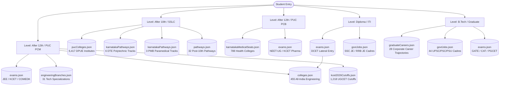

# EduSelect Repository & Data Architecture Map
**Document Version:** 1.0.0  
**Phase:** Phase 0 — Repository Architecture & Data Inventory  
**Generated Date:** October 11, 2026  
**Auditor / Engineer:** Antigravity Senior Full-Stack & Data QA Lead  

---

## 1. Executive Summary & Repository Purpose

**EduSelect** is an AI-assisted higher education counselling and decision platform built with **Next.js 14 (App Router)**, **TypeScript**, **Tailwind CSS**, **Prisma ORM with Neon Serverless Postgres**, and bundled authoritative datasets.

The platform guides Indian students through critical academic transitions:
1. **After 10th (SSLC / Matriculation):** Choosing Pre-University (PUC) streams (Science PCMB/PCMC, Commerce, Arts) across 32 Karnataka districts, Polytechnic Diplomas (DTE), or ITI technical trades.
2. **After 12th / PUC (Science PCM):** Engineering entrance exams (KCET, COMEDK, JEE), KCET 2026 rank and college cutoffs prediction across 250 institutions, and pan-India engineering college discovery across all 28 states.
3. **After 12th / PUC (Science PCB / Allied Health):** Medical (MBBS), Dental (BDS), Pharmacy (B.Pharm/D.Pharm), and Nursing seat matrices and quota allotments across 788 Karnataka institutions via official KEA matrices.
4. **Vocational & Lateral Pathways (Diploma / ITI):** Direct-diploma progression, DCET lateral entry into 2nd-year B.E., trade apprenticeships, and Junior Engineer (JE) public sector careers.
5. **After Degree / B.Tech:** Graduate career trajectories, GATE/PSU recruitments, UPSC/State PSC cadres, and postgraduate entrance routes.

---

## 2. Full Repository Directory Structure

```
edu-select/
├── .agents/                               # Custom AI agent skills and Neon extensions
│   └── skills/                            # neon, neon-auth, neon-postgres, neon-ai-gateway, etc.
├── .env.example                           # Authoritative list of 9 required environment variables
├── .env.local                             # Local workstation development credentials
├── netlify.toml                           # Serverless build and deployment configuration (@netlify/plugin-nextjs)
├── package.json                           # Core project dependencies, scripts, and build hooks
├── prisma/
│   ├── schema.prisma                      # Neon Postgres schema: User, College, Course, Placement,
│   │                                      # Review, SavedCollege, SavedComparison, CollegeOverride
│   └── migrations/                        # Relational schema migration history
├── public/                                # Static images, hero banners, college thumbnails, icons
├── raw-data/                              # Unmodified authoritative source documents:
│   ├── After_10th_Courses_and_Branches_Karnataka (1).pdf
│   ├── dpue_colleges.xlsx                 # Official Karnataka DPUE college directory
│   ├── Final seat Matrix 2022-23kannada.pdf # KEA seat matrix base
│   ├── KEA_Dental_CompleteLogReportkannada.pdf # KEA BDS counseling log
│   ├── KEA_DPharma_CompleteLogReportkannada.pdf # KEA Pharmacy log
│   ├── KEA_Nursing_r1_finkannada.pdf      # KEA Nursing round-1 seat matrix
│   ├── Medical_merged_07082026english.pdf # Official KEA MBBS intake matrix
│   ├── Karnataka_College_Data_Template-18.xlsx # Verified engineering data template
│   └── karnataka_courses_after_puc_catalogue (1).pdf # Post-PUC course handbook
├── scripts/                               # Data processing pipelines and audit scripts:
│   ├── build-colleges.cjs                 # Combines 28-states, Karnataka patch & additions -> colleges.json (455)
│   ├── build-puc-colleges.cjs             # Compiles dpue_colleges.xlsx -> pucColleges.json (6,417)
│   ├── build-medical-colleges.py          # Extracts KEA PDF logs -> karnatakaMedicalSeats.json (788)
│   ├── build-kcet-cutoffs.cjs             # Assembles UGCET cutoff matrix -> kcet2026Cutoffs.json (1,218)
│   ├── generate-career-map-doc.cjs        # Compiles taxonomy documentation
│   └── verify-all.cjs                     # Unified 6-suite verification test suite
├── src/
│   ├── app/                               # Next.js 14 App Router (Pages & APIs)
│   │   ├── (auth)/                        # /login, /signup
│   │   ├── about-data/                    # /about-data (Dataset methodology & disclosures)
│   │   ├── admin/                         # /admin, /admin/colleges, /admin/users, /admin/states
│   │   ├── ai-counsellor/                 # /ai-counsellor (Gemini-powered personalized advising)
│   │   ├── api/                           # 10 Serverless API route collections:
│   │   │   ├── admin/                     # /api/admin/users, /api/admin/colleges/[id]
│   │   │   ├── auth/                      # /api/auth/[...nextauth], /api/auth/signup
│   │   │   ├── careers/                   # /api/careers, /api/careers/[kind]/[id], /api/careers/ai
│   │   │   ├── colleges/                  # /api/colleges, /api/colleges/[id], /api/colleges/compare
│   │   │   ├── exams/                     # /api/exams/[id]
│   │   │   ├── medical-colleges/          # /api/medical-colleges
│   │   │   ├── puc-colleges/              # /api/puc-colleges
│   │   │   ├── saved/                     # /api/saved/colleges, /api/saved/comparisons
│   │   │   ├── states/                    # /api/states
│   │   │   └── telegram/                  # /api/telegram/webhook
│   │   ├── careers/                       # /careers (Interactive explorer) & /careers/[kind]/[id] (211 SSG routes)
│   │   ├── colleges/                      # /colleges (Pan-India 455 directory) & /colleges/[id]
│   │   ├── compare/                       # /compare (Engineering comparison matrix)
│   │   ├── home/                          # Legacy landing route
│   │   ├── kcet-2026-predictor/           # /kcet-2026-predictor (Interactive rank calculator & college matches)
│   │   ├── medical-allied-health/         # /medical-allied-health (KEA medical/dental/pharma/nursing matrix & modal)
│   │   ├── onboarding/                    # /onboarding (Student profile questionnaire)
│   │   ├── pathways/                      # /pathways (Stage-by-stage roadmap & Karnataka vocational tracks)
│   │   ├── puc-colleges/                  # /puc-colleges (6,417 DPUE colleges directory across 32 districts)
│   │   ├── saved/                         # /saved (Bookmarks & saved comparisons)
│   │   ├── states/                        # /states (Directory filtered by Indian states)
│   │   └── page.tsx                       # Homepage (Level selection cards, quick search, featured paths)
│   ├── components/                        # Reusable modular components
│   │   ├── features/                      # CareerCard, CollegeCard, CollegeActionButtons, ComparisonModal
│   │   └── ui/                            # Navbar, Footer, Icons, Toast, Modal, Pagination
│   ├── data/                              # Production bundled JSON datasets
│   │   ├── careers/                       # 8 Career Explorer datasets
│   │   ├── colleges/                      # Sub-assembly patch datasets
│   │   ├── colleges.json                  # 455 Engineering colleges
│   │   ├── colleges28States.json          # Legacy seed dataset
│   │   ├── karnatakaMedicalSeats.json     # 788 Health sciences colleges
│   │   ├── kcet2026Cutoffs.json           # 1,218 UGCET cutoff records
│   │   ├── pucColleges.json               # 6,417 Pre-university colleges
│   │   ├── saved.json                     # Fallback bookmark store
│   │   └── users.json                     # Seed user accounts
│   ├── lib/                               # Core libraries, business logic & state
│   │   ├── ai/                            # Gemini prompt templates & server-only callers
│   │   ├── careers/                       # repository.ts (In-memory career index & query engine)
│   │   ├── collegeRepository.ts           # College query engine with Prisma database override support
│   │   ├── kcetPredictor.ts               # UGCET rank calculation & recommendation logic
│   │   ├── savedStore.ts                  # Hybrid Prisma + JSON saved store
│   │   ├── userStore.ts                   # Hybrid Prisma + JSON user management
│   │   ├── rateLimit.ts                   # In-memory IP rate limiter
│   │   └── validation/                    # Zod schemas for validation
│   └── types/                             # TypeScript interfaces & types
│       ├── careerData.ts                  # Comprehensive career taxonomy types
│       └── index.ts                       # Common application interfaces
└── docs/                                  # Audit reports, logic verdicts, and test matrices
```

---

## 3. Comprehensive Data File Inventory

### 3.1 Primary Application Datasets (`src/data/`)

| # | Data File Path | Record Count | Data Structure | Key Fields | Consumed By (Pages & APIs) | Target Student Level |
|---|---|---:|---|---|---|---|
| 1 | `src/data/colleges.json` | **455** | JSON Array of objects | `id`, `name`, `slug`, `city`, `state`, `type`, `typeDetail`, `institutionCategory`, `rating`, `ratingDisplay`, `ratingBasis`, `nirfRank2025`, `nirfBand2025`, `nirfNote`, `fees`, `feesMax`, `feesDisplay`, `feesIsEstimate`, `overview`, `placementText`, `placementStats`, `reviewsText`, `entranceExams`, `admissionRoutes`, `routeNote`, `courses`, `coursesNote`, `totalBranchesOffered`, `affiliation`, `approval`, `established`, `dataSource`, `lastVerified`, `verificationStatus`, `imageUrl`, `sourceUrls`, `isRealData` | **Pages:** `/colleges`, `/colleges/[id]`, `/compare`, `/admin/colleges`, `/admin/colleges/[id]/edit`, `/admin/states`, `/admin/states/[stateName]`, `/states`, `/saved`, `/ai-counsellor`, `/`<br>**APIs:** `/api/colleges`, `/api/colleges/[id]`, `/api/colleges/compare`, `/api/states`, `/api/saved/colleges`, `/api/saved/comparisons`, `/api/admin/colleges/[id]`<br>**Libs:** `collegeRepository.ts`, `savedStore.ts`, `useCompareStore.ts`, `bot.ts` | **After 12th / PUC (PCM / PCMC)**<br>Engineering aspirants seeking B.E. / B.Tech degrees across India via JEE, KCET, COMEDK, state CETs; also **Diploma Lateral Entry (DCET)** |
| 2 | `src/data/pucColleges.json` | **6,417** colleges<br>(32 districts) | JSON Object (`metadata` + `colleges` array) | **Metadata:** `title`, `academicYear`, `totalColleges`, `districtsCount`, `districtBreakdown`, `managementBreakdown`<br>**Colleges Array:** `id`, `code`, `name`, `district`, `management`, `address`, `year`, `streams` (Array e.g. `["Science", "Commerce", "Arts"]`), `state` | **Pages:** `/puc-colleges`, `/careers` (via stage cards), `/` (homepage 10th card)<br>**APIs:** `/api/puc-colleges` (with search, pagination, district/management/stream filtering) | **After 10th (SSLC / Matriculation)**<br>Students in Karnataka selecting Pre-University combinations (PCMB, PCMC, Commerce, Arts) |
| 3 | `src/data/karnatakaMedicalSeats.json` | **788** institutes<br>(67 Med, 28 Dent, 43 Pharm, 650 Nurs) | JSON Object (`metadata` + `institutes` array) | **Metadata:** `title`, `academicYear`, `totalInstitutes`, `disciplineCounts`, `source`, `counsellingAuthority`<br>**Institutes Array:** `id`, `code`, `name`, `city`, `course`, `discipline`, `managementType`, `totalApprovedSeats`, `govQuotaSeats`, `entranceExam`, `address` | **Pages:** `/medical-allied-health` (directory, discipline switcher, isolated comparison modal, seat matrix filters)<br>**APIs:** `/api/medical-colleges` (search, discipline, management, city filters, pagination) | **After 12th / PUC (PCB / PCMB)**<br>Medical (NEET-UG for MBBS/BDS) and Allied Health (KCET/Merit for Pharmacy/Nursing) aspirants in Karnataka |
| 4 | `src/data/kcet2026Cutoffs.json` | **1,218** cutoffs<br>(250 colleges) | JSON Array of objects | `collegeCode`, `collegeName`, `collegeSlug`, `location`, `city`, `type`, `rating`, `branch`, `branchCode`, `cutoffs` (`GM`, `2A`, `2B`, `3A`, `3B`, `SC`, `ST`), `feesPerYear`, `avgPackageLPA`, `gmClosingRank2026`, `source` | **Pages:** `/kcet-2026-predictor`<br>**Libs:** `src/lib/kcetPredictor.ts` | **After 12th / PUC (PCM / PCMB)**<br>Karnataka engineering aspirants calculating composite KCET rank and matching seat cutoffs |
| 5 | `src/data/saved.json` | **3** colleges,<br>**1** comparison | JSON Object (`colleges` + `comparisons`) | `colleges`: `id`, `userId`, `collegeId`, `createdAt`<br>`comparisons`: `id`, `userId`, `name`, `collegeIds`, `createdAt` | **Pages:** `/saved`, `/compare`<br>**APIs:** `/api/saved/colleges`, `/api/saved/comparisons`<br>**Libs:** `src/lib/savedStore.ts` | **All Registered / Demo Users**<br>Bookmarks and saved comparison sessions |
| 6 | `src/data/users.json` | **4** users | JSON Array of objects | `id`, `name`, `email`, `passwordHash`, `role`, `createdAt`, `lastLoginAt`, `status` | **Pages:** `/admin`, `/admin/users`, `/login`<br>**APIs:** `/api/admin/users`, `/api/auth/signup`<br>**Libs:** `src/lib/userStore.ts` | **Administrators & Students**<br>Authentication, role-based access control (USER / ADMIN) |

---

### 3.2 Career Explorer Relational Datasets (`src/data/careers/`)

| # | Data File Path | Record Count | Data Structure | Key Fields | Consumed By (Pages & APIs) | Target Student Level |
|---|---|---:|---|---|---|---|
| 7 | `src/data/careers/pathways.json` | **108** pathways | JSON Object (`meta` + `items` array) | `id`, `level`, `streams`, `category`, `clusterIds`, `name`, `eligibility`, `duration`, `durationYears`, `isJob`, `entranceExamIds`, `entranceRequired`, `cost` (`govt`, `private`, `basis`), `keySubjects`, `nextSteps`, `nextExamIds`, `outcomes`, `riasec`, `subjectsLiked`, `sectors`, `outlook`, `abroadFriendly`, `isEstimate`, `asOfYear`, `sourceIds` | **Pages:** `/careers`, `/careers/[kind]/[id]`, `/pathways`, `/ai-counsellor`, `/onboarding`, `/`<br>**APIs:** `/api/careers`, `/api/careers/[kind]/[id]`, `/api/careers/ai`, `/api/careers/ai/roadmap`<br>**Libs:** `src/lib/careers/repository.ts` | **Multi-Tier Progression:**<br>• After 10th (32 pathways)<br>• After 12th (48 pathways)<br>• After ITI (8 pathways)<br>• After Diploma (10 pathways)<br>• After Degree / B.Tech (10 pathways) |
| 8 | `src/data/careers/exams.json` | **98** exams | JSON Object (`meta` + `items` array) | `id`, `name`, `conductingBody`, `type` (`ENTRANCE`, `RECRUITMENT`, `LICENSURE`, `QUALIFYING`), `forLevels`, `purpose`, `eligibility`, `frequency`, `officialSite`, `note` | **Pages:** `/careers`, `/careers/[kind]/[id]`, `/pathways`, `/ai-counsellor`, `/telegram`<br>**APIs:** `/api/exams/[id]`, `/api/careers/ai`, `/api/careers/ai/roadmap`<br>**Libs:** `src/lib/careers/repository.ts` | **All Levels:**<br>• 10th (POLYCET, AITT)<br>• 12th (JEE, NEET, KCET, COMEDK, CUET, CLAT, NDA)<br>• Diploma (DCET, Lateral CET)<br>• Degree/B.Tech (GATE, CAT, UPSC, ESE, PGCET) |
| 9 | `src/data/careers/engineeringBranches.json` | **31** branches | JSON Object (`meta`, `commonToAllBranches`, `items`) | `id`, `code`, `name`, `aliases`, `gatePaper`, `clusterIds`, `roles`, `sectors`, `topRecruiters`, `psusViaGate`, `eseEligible`, `eseStream`, `certifications`, `emergingRoles`, `salaryLPA`, `salaryNote`, `outlook`, `riasec`, `isEstimate`, `asOfYear`, `notes` | **Pages:** `/careers`, `/careers/[kind]/[id]`, `/pathways`, `/colleges`, `/colleges/[id]`<br>**Libs:** `src/lib/careers/repository.ts` | **After 12th PCM / B.Tech Undergraduates**<br>Specialization decision-making, core/tech career roles, GATE PSU eligibility |
| 10 | `src/data/careers/karnatakaPathways.json` | **14** tracks<br>(6 Poly, 3 Para, 5 Degree) | JSON Object (`meta`, `polytechnicDiplomas`, `paramedicalDiplomas`, `postPUCDegreePathways`) | `id`, `code`/`degree`, `name`, `duration`, `entryEligibility`, `curriculumAuthority`/`board`/`admissionExam`, `admissionRoute`, `lateralEntryRoute`, `salaryLPA` (`entry`, `mid`, `senior`), `karnatakaEmployers`/`hospitals`/`karnatakaCareerSectors` | **Pages:** `/pathways` (Karnataka Pathways tab with 3-tier salary bands, DTE/DCET lateral pathways) | **Karnataka Specific:**<br>• After 10th (Polytechnic & Paramedical Diplomas)<br>• After Diploma (DCET Lateral to 2nd yr B.E.)<br>• After 12th/PUC (State Professional Degrees) |
| 11 | `src/data/careers/graduateCareers.json` | **28** careers | JSON Object (`meta` + `items` array) | `id`, `qualification`, `level`, `clusterIds`, `roles`, `sectors`, `govtJobIds`, `pgOptions`, `pgExamIds`, `salaryLPA` (`entry`, `mid`, `senior`), `riasec`, `outlook`, `isEstimate`, `asOfYear`, `note` | **Pages:** `/careers`, `/careers/[kind]/[id]`, `/`<br>**Libs:** `src/lib/careers/repository.ts` | **After Degree / B.Tech / Graduation**<br>Postgraduate degrees, industry roles, matching public sector examinations |
| 12 | `src/data/careers/govtJobs.json` | **44** cadres | JSON Object (`meta`, `items` array) | `id`, `minQualification`, `exam`, `conductingBody`, `posts`, `ageLimit`, `selectionStages`, `payLevels`, `basicPayINR`, `approxInHand`, `clusterIds`, `officialSite`, `note`, `outlook`, `isEstimate`, `asOfYear` | **Pages:** `/careers`, `/careers/[kind]/[id]`, `/pathways`<br>**Libs:** `src/lib/careers/repository.ts` | **Multi-Tier Public Sector Aspirants:**<br>• 10th (SSC MTS, RRC Group D)<br>• 12th (SSC CHSL, NDA)<br>• Diploma (SSC JE, RRB JE)<br>• Degree/B.Tech (UPSC CSE, ESE, CGL, Banking PO, PSU ET) |
| 13 | `src/data/careers/careerClusters.json` | **19** clusters | JSON Object (`meta` + `items` array) | `id`, `label`, `icon`, `description`, `riasec`, `subjects` | **Pages:** `/careers`, `/careers/[kind]/[id]`, `/`, `/about-data`<br>**Libs:** `src/lib/careers/repository.ts` | **Meta-Taxonomy for All Levels**<br>Career groupings by interest, discipline and RIASEC personality type |
| 14 | `src/data/careers/taxonomy.json` | **9** config sections | JSON Object | `qualificationLevels` (8 levels), `streams` (9 streams), `riasec` (6 codes), `subjectsLiked` (11 subjects), `filters`, `aptitudeFit`, `outlookRules`, `marketFacts` | **Pages:** `/careers`, `/about-data`<br>**APIs:** `/api/careers/taxonomy`<br>**Libs:** `src/lib/careers/repository.ts` | **Global Taxonomy Configuration**<br>Defines all valid levels (`10th`, `12th`, `iti`, `diploma`, `btech`, `degree`, `professional`, `pg`) |

---

### 3.3 Data Assembly & Build-Time Patches (`src/data/colleges/`)

| # | Data File Path | Record Count | Purpose & Description | Consumed By |
|---|---|---:|---|---|
| 15 | `src/data/colleges28States.json` | **580** | Legacy master seed dataset containing 175 Karnataka colleges and 405 synthetic placeholder (`TEST-`) colleges across other states. | Used as source input by `scripts/build-colleges.cjs` (filtered during build). |
| 16 | `src/data/colleges/realColleges27States.json` | **270** | Curated real engineering colleges across 27 Indian states (10 institutions per state), complete with NIRF 2025 ranks, fees estimates, and admission routes. | Merged into `colleges.json` by `scripts/build-colleges.cjs`. |
| 17 | `src/data/colleges/karnatakaAdditions.json` | **11** | Key premier Karnataka institutions omitted from legacy seed (IISc Bangalore, IIIT Bangalore, NITK Surathkal, VTU PG Centers, etc.). | Merged into `colleges.json` by `scripts/build-colleges.cjs`. |
| 18 | `src/data/colleges/karnatakaPatch.json` | Patch file | Contains spelling fixes for Karnataka college names, city corrections, removal of duplicate `col-268`, and updated placement/NIRF stats. | Applied to Karnataka colleges by `scripts/build-colleges.cjs`. |

---

## 4. Master Mapping Table: Data -> Fields -> Usage -> Student Level Served

| Data File | Core Fields | Consuming App Surfaces | Student Level Served |
|---|---|---|---|
| **`pucColleges.json`** | `id`, `code`, `name`, `district`, `management`, `streams`, `address` | `/puc-colleges`<br>`/api/puc-colleges`<br>`/` (Stage 1 card) | **After 10th (SSLC / Matriculation)**<br>Choosing Junior College / PU combination in Karnataka across 32 districts. |
| **`karnatakaPathways.json`** | `polytechnicDiplomas` (6)<br>`paramedicalDiplomas` (3)<br>`postPUCDegreePathways` (5) | `/pathways`<br>(Karnataka Tab) | **After 10th & After Diploma**<br>DTE 3-year Polytechnic Diplomas, PMB Paramedical Diplomas, and DCET lateral entry to 2nd-year B.E. |
| **`colleges.json`** | `id`, `name`, `city`, `state`, `type`, `nirfRank2025`, `fees`, `courses`, `entranceExams`, `admissionRoutes`, `placementStats` | `/colleges`<br>`/colleges/[id]`<br>`/compare`<br>`/api/colleges`<br>`collegeRepository.ts` | **After 12th / PUC (PCM / PCMC)**<br>All-India & Karnataka Engineering aspirants seeking B.Tech / B.E. admission. |
| **`kcet2026Cutoffs.json`** | `collegeCode`, `collegeName`, `branch`, `branchCode`, `cutoffs` (GM/2A/2B/3A/3B/SC/ST), `feesPerYear`, `gmClosingRank2026` | `/kcet-2026-predictor`<br>`kcetPredictor.ts` | **After 12th / PUC (PCM / KCET)**<br>Karnataka engineering candidates calculating UGCET composite score, rank, and college admission chances. |
| **`karnatakaMedicalSeats.json`** | `id`, `code`, `name`, `city`, `discipline` (Medical/Dental/Pharmacy/Nursing), `managementType`, `totalApprovedSeats`, `govQuotaSeats`, `entranceExam` | `/medical-allied-health`<br>`/api/medical-colleges` | **After 12th / PUC (PCB / PCMB)**<br>Medical (NEET-UG) and Allied Health (KCET/Merit) aspirants in Karnataka. |
| **`pathways.json`** | `id`, `level`, `streams`, `name`, `eligibility`, `durationYears`, `cost`, `entranceExamIds`, `nextSteps`, `riasec`, `sectors`, `outlook` | `/careers`<br>`/careers/[kind]/[id]`<br>`/pathways`<br>`/api/careers`<br>`careers/repository.ts` | **Multi-Stage (10th, 12th, ITI, Diploma, Degree)**<br>Educational and career milestones across all major disciplines and stages. |
| **`engineeringBranches.json`** | `id`, `code`, `name`, `roles`, `sectors`, `topRecruiters`, `psusViaGate`, `eseEligible`, `salaryLPA`, `outlook` | `/careers`<br>`/careers/[kind]/[id]`<br>`/colleges`<br>`/pathways`<br>`careers/repository.ts` | **After 12th PCM & B.Tech Students**<br>Selecting engineering specializations, gate preparation, and campus placements. |
| **`exams.json`** | `id`, `name`, `conductingBody`, `type`, `forLevels`, `purpose`, `eligibility`, `officialSite` | `/careers`<br>`/careers/[kind]/[id]`<br>`/api/exams/[id]`<br>`careers/repository.ts` | **All Student Levels**<br>National and state level entrance examinations, eligibility rules, and official links. |
| **`graduateCareers.json`** | `id`, `qualification`, `level`, `roles`, `sectors`, `govtJobIds`, `pgOptions`, `salaryLPA` | `/careers`<br>`/careers/[kind]/[id]`<br>`careers/repository.ts` | **After Degree / B.Tech / PG**<br>Corporate career roles, postgraduate entrance pathways, and lateral sector shifts. |
| **`govtJobs.json`** | `id`, `minQualification`, `exam`, `conductingBody`, `posts`, `ageLimit`, `payLevels`, `approxInHand` | `/careers`<br>`/careers/[kind]/[id]`<br>`/pathways`<br>`careers/repository.ts` | **All Qualification Tiers**<br>Central and state public sector jobs, selection stages, and 7th CPC salary bands. |

---

## 5. Cross-Dataset Relationships & Entity Flow Diagram



---

## 6. Current Coverage Analysis & Gap Identification

Based on our complete repository audit:

### 6.1 Areas with Deep, High-Resolution Data
1. **Karnataka Pre-University Directory:** Exceptional coverage with **6,417 colleges** across all 32 educational districts with verified management types and combinations.
2. **Karnataka Engineering Cutoffs:** Strong coverage with **1,218 branch cutoffs** across 250 colleges mapped to official KEA GM/reserved category brackets.
3. **Karnataka Medical & Allied Health Seats:** Comprehensive with **788 colleges** across MBBS, BDS, Pharmacy, and Nursing with approved total vs government quota seats.
4. **Pan-India Top Engineering Colleges:** **455 colleges** across 28 states with NIRF 2025 rankings, fee estimates, and verified admission routes.
5. **Career Explorer Progression:** 108 pathways, 98 entrance exams, 31 engineering branches, 44 government jobs, and 14 Karnataka vocational tracks.

### 6.2 Data Coverage Gaps (Feeds Phase 2 & Phase 3)
1. **After 10th Polytechnic & ITI College Lists:**
   - We currently have detailed **pathway roadmaps** and **salary bands** in `karnatakaPathways.json`, but **no discrete college directory** for Polytechnic institutes (DTE) or ITI institutes (DGT).
   - *UI Requirement:* Must honestly communicate to students: *"We provide complete curriculum, eligibility, and salary pathway data for Polytechnic/ITI. College directory listing is currently available for Pre-University (PUC) colleges."*
2. **Pre-University / 11th-12th Colleges Outside Karnataka:**
   - `pucColleges.json` is strictly Karnataka-focused (DPUE). Students outside Karnataka selecting "After 10th" have pathway roadmaps, but no CBSE/ICSE/State Board directory in other states.
3. **Commerce, Arts, Law, and Pure Sciences College Directory:**
   - `colleges.json` covers Engineering institutions (B.Tech/B.E.).
   - `karnatakaMedicalSeats.json` covers Health sciences (MBBS, BDS, B.Pharm, Nursing).
   - Degree colleges for B.Com, B.A., B.Sc, BBA, and National Law Universities (NLUs) have career pathways in `pathways.json`, but do not have a dedicated directory table.
   - *UI Requirement:* Journey Engine must route commerce/arts students to pathway and exam explorer, clearly indicating college directory coverage.
4. **Postgraduate Institutes (M.Tech, MBA, MD/MS):**
   - We feature PG examinations (GATE, CAT, PGCET, NEET-PG) and graduate career maps, but directory listings are primarily undergraduate colleges.

---

## 7. Next Steps & Phase Progression

- **Phase 0 Status:** COMPLETED. No code or data edits made. Complete repository structure, data inventory, and master map documented in `docs/00_repo_map.md`.
- **Phase 1 Target:** Deep internet research to verify application logic against official regulatory portals (KEA, DPUE, NMC, AICTE, DTE, JoSAA, NIRF).
- **Awaiting User Instruction:** Antigravity is halted and waiting for user command before initiating Phase 1.
