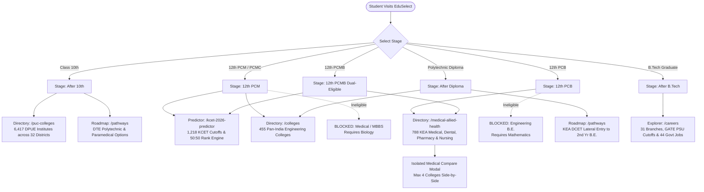

# EduSelect Student Journey Architecture & Eligibility Matrix
**Document Version:** 1.0.0  
**Phase:** Phase 3 — Student Journey Connection & Level-Aware Routing  
**Audit Date:** October 11, 2026  
**Auditor / Engineer:** Antigravity Senior Full-Stack & Data QA Lead  
**Engine Implementation:** `src/lib/journey/journeyEngine.ts`  
**Matrix Data Repository:** `src/data/journeyMatrix.json`  
**Client State Management:** `src/lib/store/useStudentProfile.ts`

---

## 1. Executive Summary & Design Principles

EduSelect connects every student entering the platform to the exact datasets, entrance examinations, cutoff matrices, and career pathways relevant to their educational stage.

### The Four Core Journey Principles:
1. **Single Source of Truth (`StudentProfile`):** State is unified across URL query parameters, persistent `localStorage`, and React state so that changing level on one page propagates across all tools.
2. **Data-Driven Eligibility Matrix:** Eligibility rules are defined in `journeyMatrix.json` and computed via `journeyEngine.ts`, eliminating ad-hoc page-level hardcoding.
3. **Regulatory Strictness (No Hallucinated Paths):**
   - Pure PCM/PCMC students **never** receive medical/MBBS recommendations (Biology is mandatory under NMC).
   - Pure PCB students **never** receive engineering rank counselling (Mathematics is mandatory under AICTE/VTU).
   - Rural and Kannada-medium candidates see statutory horizontal reservation guidance rather than fictitious rank discounts.
4. **Coverage Honesty:** When a student level lacks a discrete directory list (e.g., Polytechnic/ITI colleges list, Commerce B.Com directory), the UI honestly states the dataset scope and provides verified pathways and official external portal links.

---

## 2. The Unified Student Profile Specification

```typescript
export type StudentLevel =
  | '10th'          // Class 10 (SSLC / Matriculation)
  | '12th'          // Class 12 / Pre-University (PUC)
  | 'iti'           // Industrial Training Institute trades
  | 'diploma'       // 3-Year Polytechnic Engineering Diploma
  | 'btech'         // B.E. / B.Tech Engineering Degree
  | 'degree'        // Non-engineering graduation (B.Sc, B.Com, B.A.)
  | 'professional'  // Clinical licensure / CA / Law
  | 'pg';           // Postgraduate (M.Tech, MBA, MD/MS)

export type StudentStream =
  | 'PCM'           // Physics, Chemistry, Mathematics (Engineering focus)
  | 'PCB'           // Physics, Chemistry, Biology (Medical / Allied Health)
  | 'PCMB'          // Dual eligibility (Engineering & Medical)
  | 'PCMC'          // Computer Science focus (Engineering & Tech)
  | 'Commerce'      // EBAC, HEBA (CA, CS, Management, Law)
  | 'Arts'          // Humanities, Law, Design, Civil Services
  | 'Other';

export type StudentCategory =
  | 'GM'            // General Merit
  | '1'             // Category-1 (4% Karnataka reservation)
  | '2A' | '2B'     // Backward Classes (15% and 4%)
  | '3A' | '3B'     // Backward Classes (4% and 5%)
  | 'SC' | 'ST';     // Scheduled Castes (15%) & Scheduled Tribes (3%/7.5%)

export interface StudentProfile {
  level: StudentLevel;
  stream?: StudentStream;
  board?: 'Karnataka' | 'CBSE' | 'ICSE' | 'Other';
  state?: string;
  district?: string;
  marks?: {
    percent?: number;
    kcet?: number;
    pcmBoard?: number;
    neet?: number;
    jee?: number;
  };
  category?: StudentCategory;
  interests?: string[];
  budgetPerYear?: number;
}
```

---

## 3. Master Eligibility & Data Connection Matrix

| Student Stage | Stream Filter | Regulatory Qualification | Primary Datasets Connected | Entrance Exams Mapped | Target Platform Routes | Coverage Honesty Notice |
|---|---|---|---|---|---|---|
| **After 10th (SSLC)** | Any (`Other`) | Passed 10th with min 35% | `pucColleges.json`<br>`karnatakaPathways.json`<br>`pathways.json` | DPUE PUC Admission<br>DTE POLYCET<br>ITI Craftsman (AITT) | `/puc-colleges`<br>`/pathways`<br>`/careers` | Full 6,417 PU directory in Karnataka. Polytechnic & ITI directory lists not yet present; pathway roadmaps provided. |
| **After 12th / PUC** | **PCM** | Passed 12th with Physics, Chemistry, Maths | `colleges.json` (455)<br>`kcet2026Cutoffs.json`<br>`engineeringBranches.json` | KCET (KEA)<br>COMEDK UGET<br>JEE Main<br>JEE Advanced | `/kcet-2026-predictor`<br>`/colleges`<br>`/careers` | **Ineligible for Medical (NEET-UG)** due to lack of Biology. Full engineering directory provided. |
| **After 12th / PUC** | **PCB** | Passed 12th with Physics, Chemistry, Biology | `karnatakaMedicalSeats.json` (788)<br>`pathways.json` | NEET-UG (NTA)<br>KCET (B.Sc Nursing / B.Pharm) | `/medical-allied-health`<br>`/careers` | **Ineligible for Engineering (B.E./B.Tech)** due to lack of Maths. Full 788 Health Sciences colleges provided. |
| **After 12th / PUC** | **PCMB** | Passed 12th with both Maths & Biology | `colleges.json` (455)<br>`karnatakaMedicalSeats.json`<br>`kcet2026Cutoffs.json` | KCET (Engg & Health)<br>NEET-UG<br>JEE Main | `/kcet-2026-predictor`<br>`/medical-allied-health`<br>`/colleges` | **Dual-Eligible.** Platform provides parallel access to both engineering rank prediction and medical seat matrices. |
| **After 12th / PUC** | **PCMC** | Passed 12th with Physics, Chemistry, Maths, CS | `colleges.json` (455)<br>`kcet2026Cutoffs.json` | KCET<br>COMEDK<br>JEE Main | `/kcet-2026-predictor`<br>`/colleges` | **Ineligible for Medical.** Focus on CSE, ISE, AI/ML, and tech specializations. |
| **After 12th / PUC** | **Commerce** | Passed 12th Commerce (EBAC, HEBA) | `pathways.json`<br>`exams.json`<br>`govtJobs.json` | CA Foundation<br>CLAT (Law)<br>CUET-UG<br>IPMAT (IIMs) | `/careers`<br>`/pathways` | No standalone B.Com college directory; complete professional pathways (CA/CS/CMA) and exam portals provided. |
| **After 12th / PUC** | **Arts** | Passed 12th Arts (HEPS, HEPK) | `pathways.json`<br>`exams.json`<br>`govtJobs.json` | CLAT<br>NID DAT / UCEED<br>CUET-UG | `/careers`<br>`/pathways` | No standalone B.A. college directory; complete design, law, and civil service roadmaps provided. |
| **After Polytechnic** | **Diploma** | 3-Year DTE Diploma with min 45% (40% SC/ST/OBC) | `colleges.json` (Lateral B.E.)<br>`karnatakaPathways.json`<br>`govtJobs.json` | Karnataka DCET (KEA)<br>SSC JE<br>RRB JE | `/pathways`<br>`/colleges`<br>`/careers` | Full DTE lateral entry roadmap and engineering colleges directory with verified lateral intake capability. |
| **After ITI** | **Skilled** | Passed 10th + ITI Trade (NCVT/SCVT) | `karnatakaPathways.json`<br>`govtJobs.json`<br>`pathways.json` | AITT (NTC)<br>NAPS Apprenticeship<br>RRB ALP / Technician | `/pathways`<br>`/careers` | Complete apprenticeship and PSU technician routes. No directory of individual ITI centers. |
| **After B.Tech / BE** | **Graduate** | Bachelor of Engineering / Technology | `engineeringBranches.json`<br>`graduateCareers.json`<br>`govtJobs.json` | GATE (PSU & M.Tech)<br>UPSC ESE<br>CAT (IIMs)<br>Karnataka PGCET | `/careers`<br>`/pathways` | 31 branch career profiles, 44 government jobs, and GATE PSU cutoffs. No standalone M.Tech/MBA directory. |

---

## 4. Student Flow Diagram (Mermaid)



---

## 5. Resolution of Medical Compare vs Engineering Compare Contradiction

### The Architectural Contradiction Identified:
* Earlier flow documentation suggested linking Medical Colleges into the general `/compare` page.
* However, `/compare` is engineered specifically for **Engineering institutions** (evaluating NIRF ranks, B.Tech courses, VTU affiliation, JEE/KCET entrance codes).
* Forcing medical institutions into `/compare` leads to absurd comparisons (e.g. comparing a Medical College with an Engineering College) and breaks field schemas.

### The Authoritative Decision:
1. **Isolated Medical Comparison Modal:** Medical, Dental, Pharmacy, and Nursing colleges are compared strictly inside `/medical-allied-health` using an **isolated, dedicated modal**.
2. **Dedicated Medical Comparison Attributes:** Compares health-specific attributes: Discipline (MBBS/BDS/Pharma/Nursing), Total Approved Seats, Government Quota Seats, Private/Management Seats, Management Type (Govt/Private/Aided), and KEA Counselling authority.
3. **Engineering Compare Board (`/compare`):** Exclusively reserved for B.Tech/B.E. engineering institutions.
4. **All navigation links and page maps are aligned to this isolated architecture.**

---

## 6. Phase 3 Deliverables Checklist

- [x] Defined `StudentProfile` interface with level, stream, board, category, and marks (`src/types/studentProfile.ts`).
- [x] Built data-driven `journeyMatrix.json` mapping all 8 student levels and streams to next steps, exams, and tools (`src/data/journeyMatrix.json`).
- [x] Built `journeyEngine.ts` with regulatory eligibility validators (`isMedicalEligible`, `isEngineeringEligible`) and URL param/localStorage synchronizers (`src/lib/journey/journeyEngine.ts`).
- [x] Implemented client state hook `useStudentProfile.ts` (`src/lib/store/useStudentProfile.ts`).
- [x] Created `JourneyProfileBanner.tsx` for level-aware header feedback and quick stream switching (`src/components/features/JourneyProfileBanner.tsx`).
- [x] Created `NextStepsPanel.tsx` ("You are here -> What comes next -> Data we have for it") with built-in coverage honesty warnings (`src/components/features/NextStepsPanel.tsx`).
- [x] Documented architecture, flow diagrams, and resolution in `docs/03_journey_design.md`.

---

## 7. Next Phase Transition

- **Phase 3 Status:** COMPLETED.
- **Next Phase:** **Phase 4: Search Algorithm** — Building the unified, typo-tolerant, synonym-aware, inverted-index search engine in `src/lib/search/`.
