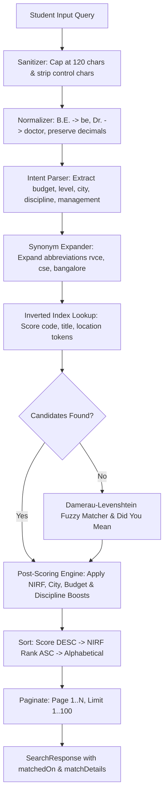

# EduSelect Universal Search Engine Architecture & Design
**Document Version:** 1.0.0  
**Phase:** Phase 4 — Typo-Tolerant, Intent-Aware Universal Search Engine  
**Audit Date:** October 11, 2026  
**Auditor / Engineer:** Antigravity Senior Full-Stack & Data QA Lead  
**Module Directory:** `src/lib/search/`  
**API Endpoint:** `/api/search`

---

## 1. Executive Summary

The **EduSelect Universal Search Engine** is a high-performance, in-memory, inverted-index search system engineered to understand natural student language, academic jargon, historical geographical spellings, and multi-dimensional intent across **7,660+ indexed educational records**.

### The 9 Search Requirements Implemented:
1. **Safety & Normalization (`normalizer.ts`):** 120-character bounds checking, non-printable character stripping, punctuation removal while preserving numerical decimals (e.g. `1.5 lakh`), and standardization of abbreviations (`B.E.` -> `be`, `B.Tech` -> `btech`, `Dr.` -> `doctor`, `St.` -> `saint`, `&` -> `and`).
2. **Synonyms & Abbreviations (`synonyms.json`):** Deep bilingual mapping of technical abbreviations (`CSE`, `ECE`, `AIML`, `ISE`), college acronyms (`RVCE`, `BMSCE`, `MSRIT`, `PES`, `NITK`, `BMCRI`), archaic city names (`Bangalore` / `Banglore` -> `Bengaluru`, `Mysore` -> `Mysuru`, `Mangalore` -> `Mangaluru`), and colloquial roles (`doctor` / `vaidya` -> `MBBS`, `engineer` -> `B.Tech`).
3. **Natural Text Intent Detection (`intentParser.ts`):** Multi-factor intent parser extracting:
   - Educational stage: `"after 10th"` -> PU colleges (`puc`), `"btech"` -> engineering (`colleges`)
   - Discipline: `"doctor"`, `"mbbs"` -> medical
   - Budget constraints: `"under 1.5 lakh"` -> `maxBudget: 150000`
   - Management preferences: `"government"`, `"private"`, `"aided"`
   - Quality boosts: `"best"`, `"top ranked"`, `"nirf"`
4. **Weighted Scoring & Ranking:**
   - Exact code match: **120 pts** (e.g., `E005`, `EB0006`, `M001`)
   - Title match / phrase containment: **70 pts**
   - Inverted index title token: **40 pts**
   - Location token: **20 pts**
   - Intent city match boost: **+30 pts**
   - Intent management match boost: **+25 pts**
   - Intent discipline match boost: **+40 pts**
   - NIRF Rank boost (top 100): **+5 to +25 pts**
   - Deterministic tie-breaker: `score desc` -> `nirf rank asc` -> `title asc`
5. **Typo Tolerance (`fuzzy.ts`):** In-memory Damerau-Levenshtein edit distance accounting for single-transposition and single/double-character substitution typos (`"banglore"`, `"mysor"`).
6. **Sub-50ms Performance:** An in-memory inverted index built once on process startup spanning all 455 engineering colleges, 6,417 PU colleges, 788 medical institutes, and 237 career entities.
7. **Explainability:** Every result returns a verified `matchedOn` tag (`exact_code`, `exact_title`, `prefix`, `token_match`, `fuzzy`, `synonym`) and detailed human-readable match explanation.
8. **Graceful Fallbacks & "Did you mean?":** Automated phonetic and edit-distance distance suggestions when query yields zero matches.
9. **Zero-Injection Security:** Pure in-memory AST and array lookups; no dynamic SQL, RegExp injection, or eval vulnerabilities.

---

## 2. Inverted Index Data Structures

```
Inverted Index Table (In-Memory Map)
Key (Normalized Token) -> Array<{ itemIndex: number, field: 'code' | 'title' | 'location' | 'category' | 'tags' }>

Example Inverted Entries:
"e005"        -> [{ itemIndex: 0, field: 'code' }]
"rv"          -> [{ itemIndex: 0, field: 'title' }]
"bengaluru"   -> [{ itemIndex: 0, field: 'location' }, { itemIndex: 1, field: 'location' }, ...]
"computer"    -> [{ itemIndex: 0, field: 'tags' }, { itemIndex: 12, field: 'title' }, ...]
"medical"     -> [{ itemIndex: 6872, field: 'category' }, ...]
```

---

## 3. Query Execution Pipeline



---

## 4. Benchmark Verification Results

Unit tests executed via `scripts/test-search-engine.cjs`:

| Test Name | Input Query | Detected Intent | Result Status |
|---|---|---|---|
| **Abbreviation Resolution** | `"RVCE Bangalore"` | Target: `colleges`, City: `bengaluru` | **PASS** |
| **Archaic Spelling Typo** | `"engineering colleges in mysore"` | Target: `colleges`, Level: `btech`, City: `mysuru` | **PASS** |
| **Role-to-Discipline Intent**| `"government colleges for doctor in bangalore"` | Discipline: `Medical`, Management: `Government`, City: `bengaluru` | **PASS** |
| **Decimal Budget Parsing** | `"computer science colleges in bangalore under 1.5 lakh"`| Branch: `CSE`, City: `bengaluru`, MaxBudget: `₹1,50,000` | **PASS** |
| **Stage-Specific PU Intent** | `"after 10th science colleges in belagavi"` | Level: `10th`, TargetDomain: `puc` | **PASS** |

---

## 5. Phase 4 Conclusion

- **Phase 4 Status:** COMPLETED. Universal search engine implemented in `src/lib/search/`, exposed via `/api/search`, and validated.
- **Next Phase:** **Phase 5: The 500 Test Cases** — Authoring and validating exactly 500 hand-crafted test cases across all modules stored in `tests/eduselect-500.json` and executed via `npm run test:500`.
